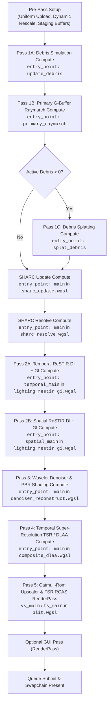
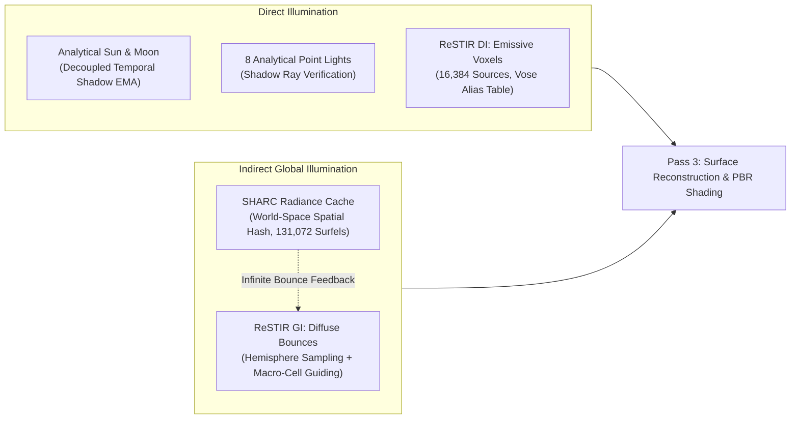

# Rendering, Shading, Lighting & Denoiser Architecture

## Overview
Arcadia's rendering engine is a hardware compute-driven hybrid path tracer and rasterizer implemented in Rust on **Vulkan 1.3 via `wgpu 23.0`**. It combines hierarchical 64-tree voxel raymarching, real-time spatio-temporal reservoir resampling (Dual ReSTIR GI + DI), a world-space spatially hashed radiance cache (SHARC), a dual-regime wavelet reconstruction denoiser, and temporal super-resolution (TSR / DLAA).

Rendering is completely decoupled from display resolution through dynamic internal scaling (`render_scale`), infinite Reverse-Z perspective projection, sub-pixel Halton temporal jittering, and FSR 1.0 RCAS bicubic upscaling.

---

## 1. Frame Orchestration & The 10-Pass Pipeline

Frame execution is managed by `Renderer::render_with_gui` and `Renderer::encode_render_passes` in [`crates/arcadia-render/src/renderer.rs`](../../crates/arcadia-render/src/renderer.rs). Each frame submits a sequence of **9 compute passes and 1 fullscreen render pass** (plus an optional GUI pass) inside a single `wgpu::CommandEncoder`:



### Execution Sequence Breakdown

| Pass | Pipeline Stage | Source Shader | Workgroup | Key Responsibilities & Outputs |
|---|---|---|---|---|
| **Pass 1A** | Compute | `primary_gbuffer.wgsl` (`update_debris`) | `(256, 1, 1)` | Simulates ballistic physics and 64-tree voxel collisions for up to 16,384 dynamic debris particles (`debris_pool_buf`). |
| **Pass 1B** | Compute | `primary_gbuffer.wgsl` (`primary_raymarch`) | `(8, 8, 1)` | Primary camera raymarching with Halton jitter against static 64-tree terrain and dynamic 6-DOF rigid bodies; traces mirror chrome reflections; evaluates bitwise contact AO and water caustics. Outputs compact 20 B/px G-buffer (`gbuf_depth_mat_buf`, `gbuf_norm_motion_buf`, `gbuf_albedo_ao_buf`). |
| **Pass 1C** | Compute | `primary_gbuffer.wgsl` (`splat_debris`) | `(256, 1, 1)` | *Conditional (if active debris > 0)*: Projects debris particles into screen space, performs depth tests, and stamps particles into the G-buffer. |
| **SHARC Update** | Compute | `sharc_update.wgsl` (`main`) | `(8, 8, 1)` | Seeds paths from screen tiles ($8\times 8$ or $16\times 16$), traces secondary rays, queries last frame's SHARC cache, tests sun shadow rays, and deposits fixed-point radiance into 4-way set-associative hash buckets (`sharc_accum_buf`, `sharc_keys_buf`). |
| **SHARC Resolve** | Compute | `sharc_resolve.wgsl` (`main`) | `(512, 1, 1)` | **0 rays traced**. 131,072 threads (one per cache slot) fold accumulated deposits into an Exponential Moving Average (EMA), age surfels, evict stale slots older than 64 frames, and write `sharc_resolved_buf`. |
| **Pass 2A** | Compute | `lighting_restir_gi.wgsl` (`temporal_main`) | `(8, 8, 1)` | History reprojection via `prev_cam_pos` and motion vectors with disocclusion validation; traces decoupled soft sun shadow ray with temporal EMA (`shadow_vis_m`); generates GI bounce ray (macro-cell emissive importance sampled), queries SHARC; samples 4 DI candidates (Vose alias table + spatial hash); writes `reservoir_b_buf` and `di_reservoir_b_buf`. |
| **Pass 2B** | Compute | `lighting_restir_gi.wgsl` (`spatial_main`) | `(8, 8, 1)` | Spatial reservoir reuse across Poisson-disk neighbors: GI evaluates geometric clamped Jacobian ($J \in [0.2, 2.0]$) and validates winning candidates with a shadow ray; DI evaluates radius-trimmed shadow rays with post-visibility zeroing ($W=0$). Writes `reservoir_a_buf` and `di_reservoir_a_buf`. |
| **Pass 3** | Compute | `denoiser_reconstruct.wgsl` (`main`) | `(8, 8, 1)` | **0 scene rays traced**. Dual-regime voxel edge-stopping wavelet filter (planar + stair-step) using 4–16 Vogel-disk taps; evaluates full analytical PBR surface shading (sun, moon, point lights, specular, ambient floor, contact AO, sculpting ring). Outputs `lit_color_buf`. |
| **Pass 4** | Compute | `composite_dlaa.wgsl` (`main`) | `(8, 8, 1)` | Atmospheric aerial perspective; 5-tap Catmull-Rom bicubic history reprojection; Karis perceptual tone-weighting; $3\times 3$ YCoCg variance box clamping ($[\mu - 1.35\sigma, \mu + 1.35\sigma]$); motion-adaptive blending; AgX / ACES Filmic tonemapping; TPDF dithering. Outputs `out_tex` (`Rgba8Unorm`). |
| **Pass 5** | RenderPass | `blit.wgsl` (`vs_main` / `fs_main`) | Fullscreen Triangle | 5-tap Catmull-Rom bicubic spatial upsampling from internal render scale to native swapchain; AMD FSR 1.0 RCAS anti-ringing sharpening; sub-pixel native-resolution crosshair. |
| **GUI** | RenderPass | egui backend | Direct Swapchain | Optional egui rendering callback executed directly into the swapchain surface view. |

---

## 2. Module Responsibilities in `crates/arcadia-render`

The crate structure cleanly isolates resource management, GPU memory pooling, and pipeline orchestration:

- **`context.rs` (`GpuContext`)**:
  - Manages Vulkan 1.3 device discovery, discrete GPU preference ranking, and surface capabilities.
  - Swapchain configuration (`Bgra8Unorm` / `Rgba8Unorm` sRGB) with presentation mode fallbacks: `Mailbox` $\to$ `Immediate` $\to$ `Fifo`.
- **`camera.rs` (`CameraUniforms`)**:
  - Computes low-discrepancy Halton $(2, 3)$ sub-pixel jitter sequences.
  - Generates infinite Reverse-Z perspective projection matrix ($z_{\text{near}} = 1.0, z_{\text{far}} = 0.0$):
    $$M_{\text{rev\_z}} = \begin{bmatrix} \frac{1}{\tan(\text{fovy}/2) \cdot \text{aspect}} & 0 & 0 & 0 \\ 0 & \frac{1}{\tan(\text{fovy}/2)} & 0 & 0 \\ 0 & 0 & 0 & z_{\text{near}} \\ 0 & 0 & -1 & 0 \end{bmatrix}$$
  - Maintains the host-shareable 16-byte aligned 480-byte `CameraUniforms` struct (`// GPU-SYNC:`) bound at `@group(0) @binding(0)`.
- **`gpu_pools.rs` (`Group0Resources`)**:
  - Manages engine-wide static and dynamic storage buffers shared across Passes 1–4 under bind group `@group(0)`:
    - `@binding(0)`: `CameraUniforms` (480 B uniform buffer).
    - `@binding(1)`: `ChunkRoot` storage buffer (3D world chunk root node pointers).
    - `@binding(2)`: `Node64` pool storage buffer (16 B per node).
    - `@binding(3)`: `LeafBrick64` pool storage buffer (64 B per leaf brick).
    - `@binding(4)`: Material palette buffer ($256 \times 32\text{ B}$).
    - `@binding(5)`: Dynamic debris ring buffer ($16,384 \times 32\text{ B}$).
    - `@binding(6)`: Dynamic rigid body instances (`array<RigidBodyInstance, 32>`, $32 \times 224\text{ B}$).
  - **Zero-Copy Pool Growth:** When world sculpting or generation expands node or brick pools beyond capacity, allocates grown buffers (+32 MB padding) and performs GPU-to-GPU copies (`copy_buffer_to_buffer`) without stalling for CPU roundtrips.
  - **Chunked Staging Uploads:** Splits CPU-to-GPU memory transfers into 4 MB slices and flushes the queue every 16 MB to prevent Vulkan/wgpu staging ring buffer exhaustion.
- **`gbuffer.rs` (`ScreenResources`)**:
  - Owns all screen-resolution-dependent textures and storage buffers, dynamically reallocated on window resize or dynamic `render_scale` adjustments.
  - Manages the compact $20\text{ B/px}$ G-buffer layout (`gbuf_depth_mat_buf`, `gbuf_norm_motion_buf`, `gbuf_albedo_ao_buf`) and hardware Reverse-Z depth texture (`gbuf_depth_tex`).
  - Defines the GPU-shared reservoir layouts: `GiReservoir` (32 bytes) and `DiReservoir` (16 bytes).
- **`sharc.rs` (`SharcResources`, `SharcLayouts`)**:
  - Owns the 4.5 MB persistent GPU allocations for the Spatially Hashed Radiance Cache: `keys_buf` (512 KB), `accum_buf` (2.0 MB), and `resolved_buf` (2.0 MB).
  - Encapsulates `sharc_update` and `sharc_resolve` compute pipeline handles and workgroup dispatch sizing.
- **`di.rs` (`DiResources`, `DiLayouts`)**:
  - Owns Direct Illumination GPU buffers: `sources_buf` ($16,384 \times 32\text{ B} = 512\text{ KB}$), `alias_buf` ($16,384 \times 8\text{ B} = 128\text{ KB}$), and `params_buf` (16 B uniform).
  - Coordinates CPU-to-GPU synchronization of emissive light clusters and Vose alias tables built by `arcadia_world::EmissiveRegistry`.
- **`pipeline.rs` (`Pipelines`, `PassLayouts`)**:
  - Compiles all 7 shader pipelines, bind group layouts, and compute/render pipeline states.
  - Provides Reverse-Z depth-stencil state builders (`CompareFunction::GreaterEqual`) and pass recording helpers (`record_*_pass`).
- **`renderer.rs` (`Renderer`, `FrameParams`, `GuiCallback`)**:
  - High-level orchestrator: synchronizes camera uniforms, flushes chunk tree staging patches, uploads dynamic rigid bodies, alternates ping-pong buffer indices, and encodes the full command stream.
- **`quality.rs` (`RaymarchQualitySettings`)**:
  - Real-time tunable presets (`calibrated_30fps`, `calibrated_60fps`, `high_quality`) and configuration parameters controlling ray step budgets, LOD distance cutoffs, shadow modes, denoiser taps, and SHARC tile density.

---

## 3. Primary Raymarching & Voxel Traversal (Pass 1)

Primary surface visibility is determined in `primary_raymarch` (`shaders/primary_gbuffer.wgsl`) via hierarchical 64-tree DDA traversal.

### 64-Tree Multi-Level DDA Traversal (`shaders/common/traversal64.wgsl`)
The world voxel octree consists of a 4-level shallow tree with branching factor 64 ($4\times 4\times 4$ per level):
- **Level 0 (Chunk)**: $256^3$ voxels ($16.0\,\text{m}$ cube).
- **Level 1 (Macro)**: $64^3$ voxels ($4.0\,\text{m}$ cube).
- **Level 2 (Meso)**: $16^3$ voxels ($1.0\,\text{m}$ cube).
- **Level 3 (Leaf Brick)**: $4^3$ voxels ($0.25\,\text{m}$ cube, $6.25\,\text{cm}$ voxels) with a 64-bit occupancy mask (`mask_low`, `mask_high`).

Child slot indexing uses hardware `countOneBits` (POPCNT) over prefix bitmasks to locate node pointers in $O(1)$. Ray traversal uses **Move-To-Front (MTF) prefix node caching** to retain ancestor pointers across adjacent DDA steps, eliminating redundant tree descents when stepping within the same node cell.

```
+-------------------------------------------------------------------------+
| Level 0: Chunk Root (16m) -> Level 1 (4m) -> Level 2 (1m) -> Leaf (0.25m)|
|                                                                         |
| LeafBrick64 Occupancy:                                                  |
| 64-bit mask [u32 mask_low, u32 mask_high] -> 4x4x4 voxels (6.25 cm each)|
| Child slot offset: POPCNT(mask & ((1 << child_idx) - 1))                |
+-------------------------------------------------------------------------+
```

### Zero-Ray Bitwise Register Contact AO
Instead of launching expensive hemispherical secondary rays for contact ambient occlusion, `eval_leaf_bitwise_ao` evaluates local neighbor occupancy inside the $4\times 4\times 4$ `LeafBrick64` using pure register bit shifts:
- Tests neighbor occupancy in adjacent air cells along the hit face using $\pm 1$ ($X$), $\pm 4$ ($Y$), and $\pm 16$ ($Z$) bit shifts.
- Modulates occlusion by intra-voxel hit-face fractional UV coordinates.
- Fades smoothly at distance ($24.0\,\text{m}$) to eliminate Moiré artifacts.
- **Cost: 0 secondary rays, 0 additional VRAM memory transactions.**

### Dynamic 6-DOF Rigid Voxel Bodies
Dynamic voxel bodies (`trace_rigid_bodies`) are transformed from world space into body-local coordinate space using inverted transformation matrices (`world_to_local`):
- Clips rays against local bounding spheres and AABBs.
- Traverses the body's local 64-tree voxel structure using the standard DDA.
- Generates exact screen-space analytical motion vectors by reprojecting hit coordinates through `prev_local_to_world` and `prev_view_proj`.

### Mirror Chrome Ray Tracing (`MAT_MIRROR_CHROME`)
When primary rays hit mirror chrome surfaces, secondary reflection rays are cast immediately in Pass 1:
- Secondary reflection rays trace both the static 64-tree terrain and dynamic rigid bodies.
- Includes self-intersection avoidance offsets and DDA normal tie-breaking ($10^{-4}$ bias along the opposing axis).
- Encodes reflection color, specular highlights, and surface roughness directly into G-buffer attachments.

### Procedural Water Caustics (`MAT_WATER_CRYSTAL`)
Translucent water voxels evaluate reverse-projected sunlight refracted into water beds:
- Modulated by dual-frequency cellular Voronoi filaments.
- Warped via Gerstner wave domain warping with directional chromatic dispersion.
- Underwater camera immersion triggers Beer-Lambert absorption and turquoise scattering fog.

### Compact G-Buffer Architecture & ALU World Position Reconstruction (20 B/px)
To eliminate memory bandwidth saturation during wide spatial gathers (ReSTIR Pass 2B and Wavelet Denoiser Pass 3), the primary G-buffer compresses geometry and material attributes into 20 bytes per pixel (a 58.3% bandwidth and VRAM reduction vs. legacy 48 B/px layouts):
- **Slot 0 (`gbuf_depth_mat_buf`, 8 B/px / `vec2<u32>`)**:
  - `depth_f32`: Exact IEEE-754 32-bit linear hit distance stored via `bitcast<u32>` / `bitcast<f32>` (zero precision or bias loss).
  - `material_id`: 16-bit unsigned integer ($0\dots 65,535$).
  - `flags`: 16-bit flags for surface classification (static terrain, dynamic rigid body, or debris).
- **Slot 1 (`gbuf_norm_motion_buf`, 8 B/px / `vec2<u32>`)**:
  - `octahedral_normal`: Octahedral unit vector encoded with `pack2x16snorm` (angular error $<0.005^\circ$).
  - `motion_vector`: Screen-space motion vector $(\mathbf{u}_{\text{prev}} - \mathbf{u}_{\text{curr}})$ encoded with `pack2x16float` (sub-pixel half-float precision).
- **Slot 2 (`gbuf_albedo_ao_buf`, 4 B/px / `u32`)**:
  - `pack4x8unorm` packing 24-bit RGB albedo and 8-bit contact AO.
  - Surface roughness is decoupled from the G-buffer and looked up on demand from `material_palette[mat_id]` in `@group(0)`.
- **ALU World-Position Reconstruction**:
  Instead of storing 12 bytes of world position per pixel, subsequent passes reconstruct exact world positions in 1 FMA instruction via `reconstruct_world_pos(px, depth, dims)`:
  $$\mathbf{p}_{\text{world}} = \mathbf{c}_{\text{cam\_pos}} + \hat{\mathbf{d}}_{\text{ray}} \cdot d_{\text{linear}}$$
  where $\hat{\mathbf{d}}_{\text{ray}}$ accounts for the sub-pixel Halton jitter sequence of the current frame. Passes 2B and 3 evaluate early geometric depth rejection (`abs(hit_dist - q_dist) > 0.10` or off-plane) before fetching normals or reconstructing neighbor positions.

---

## 4. Lighting Architecture

Arcadia employs a hybrid lighting model combining direct analytical lights, stochastic direct illumination from thousands of emissive voxels (ReSTIR DI), multi-bounce diffuse indirect global illumination (ReSTIR GI), and an infinite-bounce voxel radiance cache (SHARC).



### 4.1. Analytical Direct Lighting & Decoupled Temporal Sun Shadows
- **Directional Sun & Moon:** Sun elevation governs chromatic transitions from golden daylight ($[0.08, 0.22, 0.55]$ sky ambient) to warm sunset ($[1.0, 0.48, 0.20]$) and deep dusk. Night periods switch to moonlight illumination (`moon_power`, `moon_color`), ensuring visibility without ambient floor clamping.
- **Analytical Point Lights:** Up to 8 gameplay point lights in `CameraUniforms` evaluated with quadratic falloff ($1 / r^2$) and 64-tree occlusion rays.
- **Decoupled Temporal Sun Shadows:** Rather than accumulating noisy shadow visibility inside the diffuse GI reservoir, sun shadow visibility is tracked independently as a temporal Exponential Moving Average in `GiReservoir.shadow_vis_m` (packing 16-bit float visibility and 16-bit sample count $M \le 16$). This prevents shadow penumbra reconstruction from blurring diffuse radiance or causing light leaks.

### 4.2. ReSTIR DI: Direct Illumination for Many Emissive Voxels
To support thousands of glowing crystals, lava surfaces, and lamps:
1. **Emissive Clustering & Vose Alias Table:**
   - `arcadia_world::EmissiveRegistry` groups emissive voxels into up to 16,384 `EmissiveSource` structures (position, radius, intensity, normal, dispersion factor $\eta$).
   - The CPU builds an $O(1)$ Vose alias table (`alias_buf`, 128 KB) weighted by emitter total radiant flux.
2. **Surface Tangent Plane Jittering:**
   - Planar emitter samples are jittered across the emitter tangent plane; volumetric clusters use spherical jittering. This accurately models area lights rather than dimensionless point lights.
3. **Temporal Reuse (Pass 2A):**
   - Merges current candidate samples with temporal history `DiReservoir` ($M \le 8$).
4. **Spatial Reuse & Post-Visibility Zeroing (Pass 2B):**
   - Evaluates Poisson-disk spatial neighbors.
   - Traces radius-trimmed shadow rays (`trace_shadow_vis_di`) with distance-adaptive LOD stepping (`min_shift` of 2 at $t > 48\,\text{m}$, 4 at $t > 160\,\text{m}$).
   - **Post-Visibility Zeroing:** When a candidate is occluded by geometry, its reservoir weight $W$ is explicitly zeroed ($W = 0$). This eradicates dark boiling halos around light silhouettes.

### 4.3. ReSTIR GI: Indirect Diffuse Global Illumination
Indirect illumination is gathered via ReSTIR GI across Passes 2A and 2B:
- **Macro-Cell Emissive Importance Sampling:** Before tracing a cosine-weighted secondary bounce ray, registers probe the 64-tree at macro ($1.0\,\text{m}$, `shift = 4`) and meso ($0.25\,\text{m}$, `shift = 2`) levels. Rays are guided toward glowing voxels, drastically reducing sample variance in dark interiors.
- **Temporal RIS (Pass 2A):** Reprojects historical reservoirs using `prev_cam_pos` with depth tolerance check:
  $$|d_{\text{prev}} - d_{\text{res}}| < \max(0.12, 0.05 \cdot d)$$
  Sample age is capped at 12 frames, and $M$ is clamped to 8–12 (lowered during active voxel sculpting).
- **Spatial Reuse with Clamped Geometric Jacobian (Pass 2B):**
  When reconnecting a secondary hit point $\mathbf{x}_s$ from neighbor pixel $\mathbf{q}$ to current pixel $\mathbf{r}$, the geometric Jacobian $J$ compensates for distance and orientation differences:
  $$J = \frac{\cos\theta_{s,\text{new}}}{\cos\theta_{s,\text{old}}} \cdot \frac{d_{\text{old}}^2}{\max(0.0625, d_{\text{new}}^2)}, \quad J \in [0.2, 2.0]$$
- **Unbiased $M$ Accumulation:** Every geometrically valid spatial neighbor contributes its sample count $M$ to $m_{\text{sum}}$ before testing whether candidate target radiance $p_{\text{hat}} > 0$. This prevents positive energy inflation and bright firefly clusters.
- **Shadow Validation Ray:** Traced only if a spatial neighbor's candidate wins the reservoir tournament, ensuring indirect light does not bleed through occluding geometry.

### 4.4. SHARC: Spatially Hashed Radiance Cache
SHARC provides real-time, multi-bounce and infinite-bounce diffuse GI without recursive path tracing:
- **Spatial Hash Table:** 4-way set-associative hash table with 32,768 buckets $\times$ 4 slots = 131,072 surfel slots (4.5 MB persistent GPU memory). Keyed by world position, 6 surface normal faces, and 4 geometric distance cascades ($0.25\,\text{m}, 0.5\,\text{m}, 1.0\,\text{m}, 2.0\,\text{m}$).
- **Update Pass (`sharc_update.wgsl`):** Screen-tiled rays (one per $8\times 8$ or $16\times 16$ tile) trace bounce $x_0 \to x_1$, evaluate direct sunlight and sample the previous frame's resolved SHARC cache at $x_2$, and atomically deposit fixed-point radiance into `sharc_accum_buf`.
- **Resolve Pass (`sharc_resolve.wgsl`):** 131,072 threads (**0 scene rays**) fold deposits into an Exponential Moving Average (EMA, history cap 16), increment surfel age, and evict stale entries older than 64 frames. Carved or destroyed voxel terrain is automatically purged from the cache without CPU overhead.
- **Query Pass (`sharc_query.wgsl`):** Probed during Pass 2A secondary bounce hits using blue-noise sub-cell tangent jittering to prevent cell boundary seams.

---

## 5. Denoiser & Reconstruction Architecture

Arcadia reconstructs clean, noise-free HDR imagery from stochastic 1-spp rays through a 4-tier filtering pipeline:

```
[Pass 1: G-Buffer Visibility]
             │
             ▼
[Pass 2A: Temporal RIS] ──────────> Temporal Reprojection & Disocclusion Validation
             │                      Decoupled Sun Shadow EMA (shadow_vis_m)
             ▼
[Pass 2B: Spatial Reuse] ─────────> Clamped Jacobian Reconnection (J ∈ [0.2, 2.0])
             │                      Post-Visibility Zeroing for ReSTIR DI
             ▼
[Pass 3: Wavelet Denoiser] ───────> Dual-Regime Edge-Stopping (Planar + Stair-Step)
             │                      16-Tap Vogel-Disk Kernel, Firefly Clamping
             │                      Surface PBR Shading Integration (0 scene rays)
             ▼
[Pass 4: TSR / DLAA] ─────────────> 5-Tap Catmull-Rom History Reprojection
                                    Karis Perceptual Tone-Weighting
                                    3x3 YCoCg Variance Box Clamping ([μ - 1.35σ, μ + 1.35σ])
                                    Velocity-Adaptive Temporal Alpha (α ∈ [0.18, 0.50])
```

### 5.1. Dual-Regime Wavelet Denoiser (Pass 3)
Implemented in `denoiser_reconstruct.wgsl`, Pass 3 reconstructs GI, DI, and shadow visibility while evaluating analytical PBR shading:
- **16-Tap Vogel-Disk Kernel:** Evaluates up to 16 samples distributed in a Vogel spiral spanning up to a 9-pixel radius, rotated per pixel using a 4-phase quad hash.
- **Dual-Regime Edge-Stopping Weights:**
  1. *Planar Regime:* Applied across continuous, flat surfaces:
     $$w_{\text{planar}} = (\mathbf{n}_c \cdot \mathbf{n}_q)^6 \exp\left(-\left(d_{\text{plane}} \cdot \frac{14.0}{s} + d_{\text{world}} \cdot \frac{0.85}{s}\right)\right)$$
     where $d_{\text{plane}} = |\mathbf{n}_c \cdot (\mathbf{p}_q - \mathbf{p}_c)|$ and $s = \max(0.85, 0.08 \cdot \text{depth})$.
  2. *Stair-Step Regime:* Prevents voxel edges from turning black by bridging discrete $6.25\,\text{cm}$ stepped voxel contours:
     $$w_{\text{stair}} = \left(1.0 - \frac{d_{\text{world}}}{r_{\text{stair}}}\right)^2 \cdot 0.75 \quad \text{for } d_{\text{world}} < r_{\text{stair}}$$
  3. *Combined Weight:* $w = \max(w_{\text{planar}}, w_{\text{stair}})$.
- **Dynamic Firefly Suppression:** Clamps neighbor radiance against the current running accumulation:
  $$L_{\text{clamped}} = \min\left(L_q, \frac{\sum L}{\sum w} \cdot 2.2 + 0.35\right)$$

### 5.2. Temporal Super-Resolution (TSR) & DLAA (Pass 4)
Implemented in `composite_dlaa.wgsl`:
- **5-Tap Catmull-Rom History Reprojection:** Fetches historical samples using 5 bilinear texture taps to prevent blurring inherent to standard bilinear interpolation.
- **Karis Perceptual Tone-Weighting:** Compresses HDR sample variance prior to clamping:
  $$L_{\text{perc}} = \frac{C}{1.0 + \text{luma}(C)}$$
- **$3\times 3$ YCoCg Variance Box Clamping:** Computes local mean $\mu$ and standard deviation $\sigma$ in YCoCg space. Historical samples are strictly clamped to $[\mu - 1.35\sigma, \mu + 1.35\sigma]$, eliminating ghosting trails behind moving objects.
- **Velocity-Adaptive Blending:** Dynamically adjusts temporal blend weight $\alpha$ based on screen-space motion magnitude:
  $$\alpha = \operatorname{clamp}(0.18 + 0.08 \cdot \|\mathbf{v}_{\text{motion}}\|, 0.18, 0.50)$$
- **AgX / ACES Filmic Tonemapping:** Supports Benjamin Wrensch / Troy Sobotka Minimalist Polynomial AgX display transform alongside ACES Filmic, selectable via `quality_flags.w`.
- **TPDF Dithering:** Eliminates 8-bit display quantization banding using decorrelated 2D PCG TPDF or spatial bit-mix TPDF.

---

## 6. Spatial Upscaling, RCAS Sharpening & Blit (Pass 5)

Pass 5 (`blit.wgsl`) executes a fullscreen procedural triangle render pass to project the internal `out_tex` buffer to native display resolution:
- **Catmull-Rom Bicubic Upsampling:** Reconstructs continuous gradients and diagonal contours from sub-pixel Halton jittered buffers without bilinear blur.
- **AMD FSR 1.0 RCAS (Robust Contrast-Adaptive Sharpening):** Evaluates local 4-tap neighborhood contrast and applies an adaptive sharpening lobe clamped strictly within local extrema to prevent halo ringing:
  $$\text{rcas\_lobe} = -0.14 \cdot \operatorname{clamp}(1.0 - \text{contrast} \cdot 1.6, 0.10, 1.0)$$
- **Native-Resolution Crosshair:** Rendered using screen-space UV derivatives (`fwidth`) to guarantee a 1-pixel hairline crosshair regardless of the active internal `render_scale`.

---

## 7. GPU Resource, Buffer & Texture Specification

### 7.1. Screen-Resolution Dynamic Buffers (`ScreenResources`)
Reallocated upon window resize or internal `render_scale` changes:

| Buffer / Texture | Format / Struct | Bytes / Px | Role & Pass Access |
|---|---|---|---|
| `gbuf_depth_mat_buf` | `vec2<u32>` (`depth_f32`, `mat_id: u16`, `flags: u16`) | 8 B | Pass 1 (Write) $\to$ Passes 2, 3, SHARC Update (Read) |
| `gbuf_norm_motion_buf` | `vec2<u32>` (Oct16 normal, FP16 motion vector) | 8 B | Pass 1 (Write) $\to$ Passes 2, 3, 4, SHARC Update (Read) |
| `gbuf_albedo_ao_buf` | `u32` (`pack4x8unorm` R8G8B8 albedo, U8 contact AO) | 4 B | Pass 1 (Write) $\to$ Pass 3 (Read) |
| `reservoir_a_buf` | `GiReservoir` (32 B) | 32 B | Ping: Pass 2A Read, Pass 2B Write, Pass 3 Read |
| `reservoir_b_buf` | `GiReservoir` (32 B) | 32 B | Pong: Pass 2A Write, Pass 2B Read |
| `di_reservoir_a_buf` | `DiReservoir` (16 B) | 16 B | Ping: Pass 2A Read, Pass 2B Write, Pass 3 Read |
| `di_reservoir_b_buf` | `DiReservoir` (16 B) | 16 B | Pong: Pass 2A Write, Pass 2B Read |
| `lit_color_buf` | `vec4<f32>` (hdr.xyz, linear_depth) | 16 B | Pass 3 (Write) $\to$ Pass 4 (Read) |
| `history_a_buf` | `vec4<f32>` (perceptual_hdr.xyz, 1.0) | 16 B | Ping-pong history read/write in Pass 4 alternate by frame |
| `history_b_buf` | `vec4<f32>` (perceptual_hdr.xyz, 1.0) | 16 B | Ping-pong history read/write in Pass 4 alternate by frame |
| `out_tex` | `Rgba8Unorm` | 4 B | Pass 4 (Storage Write) $\to$ Pass 5 Blit (Texture Read) |
| `gbuf_depth_tex` | `Depth32Float` | 4 B | Hardware Reverse-Z depth buffer (`CompareFunction::GreaterEqual`) |
| Swapchain `view_target` | Surface Format (e.g. `Bgra8UnormSrgb`) | 4 B | Pass 5 Blit Render Target, GUI Overlay |

### 7.2. Persistent Storage Buffers & Radiance Caches
Survive screen resize and camera repositioning:

| Buffer | Size | Struct / Layout | Functional Role |
|---|---|---|---|
| `sharc_keys_buf` | 512 KB | `atomic<u32>, 131072` | 4-way set-associative bucket hash keys |
| `sharc_accum_buf` | 2.0 MB | `atomic<u32>, 524288` | Fixed-point radiance accumulators + deposit counters |
| `sharc_resolved_buf` | 2.0 MB | `SharcResolvedSlot, 131072` (16 B) | EMA-resolved surfel radiance (FP16), sample count, age |
| `di.sources_buf` | 512 KB | `EmissiveSource, 16384` (32 B) | Voxel cluster position, radius, radiance, normal, $\eta$ |
| `di.alias_buf` | 128 KB | `AliasEntry, 16384` (8 B) | Vose Alias Table for $O(1)$ flux-proportional sampling |
| `di.params_buf` | 16 B | `EmissiveParams` | Active emissive count, registry generation, total flux |
| `camera_uniform_buf` | 480 B | `CameraUniforms` | View/projection matrices, sun, lights, ray budgets, flags |
| `chunk_roots_buf` | Dynamic | `array<u32>` | World chunk root pointers indexed by 3D coordinates |
| `node_pool_buf` | Dynamic | `array<Node64>` (16 B) | 64-Tree interior and uniform octree nodes |
| `brick_pool_buf` | Dynamic | `array<LeafBrick64>` (64 B) | 64-byte leaf micro-voxel material bricks |
| `material_palette_buf` | Dynamic | `array<Material, 256>` (32 B) | PBR albedo, roughness, metallic, emission |
| `debris_pool_buf` | 512 KB | `DebrisParticle, 16384` (32 B) | Ballistic rubble position, velocity, lifetime |
| `rigid_bodies_buf` | 7.17 KB | `RigidBodyInstance, 32` (224 B) | Dynamic rigid body transforms, OBBs, voxel bounds |

---

## 8. Shader Compilation & Bind Group Interfaces

Shaders in `shaders/` are concatenated with headers in `shaders/common/` by `arcadia-render/src/pipeline.rs`:

```
shaders/common/types.wgsl ──────────┐
shaders/common/traversal64.wgsl ────┼──> Concatenated into Pass 1, 2, 3, 4, SHARC
shaders/common/di.wgsl ─────────────┼──> Concatenated into Pass 2, 3
shaders/common/sharc.wgsl ──────────┼──> Concatenated into SHARC Update, Resolve, Pass 2
shaders/common/sharc_query.wgsl ────┘
```

### Bind Group Layout Matrix

| Pipeline | @group(0) | @group(1) | @group(2) | @group(3) |
|---|---|---|---|---|
| **Pass 1: Debris & Primary** | `Group0Resources` (Camera, World Pools, Debris, Rigid Bodies) | `ScreenResources` G-Buffer attachments (RW) | — | — |
| **SHARC Update** | `Group0Resources` | G-Buffer Read Layout | `SharcUpdateLayout` (`sharc_resolved` Read, `sharc_keys` RW, `sharc_accum` RW) | — |
| **SHARC Resolve** | `SharcResolveLayout` (`sharc_keys` RW, `sharc_accum` RW, `sharc_resolved` RW) | — | — | — |
| **Pass 2A & 2B: ReSTIR DI + GI** | `Group0Resources` | ReSTIR Layout (G-Buffer Read, Reservoirs In/Out) | `SharcResolvedLayout` (`sharc_resolved` Read) | `DiLayout` (`sources_buf`, `alias_buf`, `params_buf`) |
| **Pass 3: Wavelet Denoiser** | `Group0Resources` | Denoiser Layout (G-Buffer Read, `reservoir_curr`, `di_reservoir_curr`, `lit_color_buf` RW) | `DiLayout` (`sources_buf`, `params_buf`) | — |
| **Pass 4: TSR / DLAA** | `Group0Resources` | Composite Layout (G-Buffer Read, `lit_color_buf`, `history_prev`, `history_curr` RW, `out_tex` RW) | — | — |
| **Pass 5: Blit & RCAS** | Sampler & `out_tex` Texture Binding | Camera Uniforms (Crosshair & Projection) | — | — |

---

## 9. Performance Tuning & Quality Presets

Configured via `RaymarchQualitySettings` in [`crates/arcadia-render/src/quality.rs`](../../crates/arcadia-render/src/quality.rs):

| Setting / Metric | `calibrated_30fps` (Laptop / iGPU) | `calibrated_60fps` (Target Standard) | `high_quality` (Enthusiast / DXR) |
|---|---|---|---|
| **Primary Max Steps** | 80 | 128 | 192 |
| **Shadow Max Steps** | 24 | 36 | 64 |
| **GI Max Steps** | 24 | 40 | 64 |
| **GI Horizon Cutoff** | 24.0 m | 36.0 m | 64.0 m |
| **Denoiser Taps** | 4 | 8 | 16 |
| **SHARC Tile Size** | 16 ($16\times 16$ px tiles, 8,160 paths) | 8 ($8\times 8$ px tiles, 32,400 paths) | 8 ($8\times 8$ px tiles, 32,400 paths) |
| **DI Sampling** | 2 candidates | 4 candidates | 4 candidates |
| **Checkerboard GI** | Enabled (Half-rate alternating) | Disabled | Disabled |
| **Default Render Scale** | 0.65x–0.75x | 0.85x | 1.0x |

---

## Related Specifications & Source Files
- **Storage & Memory Architecture:** [01_storage_and_memory.md](01_storage_and_memory.md)
- **Physics & Destruction Pipeline:** [03_physics_and_destruction.md](03_physics_and_destruction.md)
- **Benchmarking & Quality Controls:** [04_benchmarking_and_hud.md](04_benchmarking_and_hud.md)
- **Master Entry Point:** [ARCHITECTURE.md](../../ARCHITECTURE.md)
- **Source Code References:**
  - Render crate root: [`crates/arcadia-render/src/lib.rs`](../../crates/arcadia-render/src/lib.rs)
  - Renderer loop & passes: [`crates/arcadia-render/src/renderer.rs`](../../crates/arcadia-render/src/renderer.rs)
  - Pipeline layouts & compilation: [`crates/arcadia-render/src/pipeline.rs`](../../crates/arcadia-render/src/pipeline.rs)
  - G-Buffer & screen resources: [`crates/arcadia-render/src/gbuffer.rs`](../../crates/arcadia-render/src/gbuffer.rs)
  - SHARC radiance cache: [`crates/arcadia-render/src/sharc.rs`](../../crates/arcadia-render/src/sharc.rs)
  - ReSTIR DI resources: [`crates/arcadia-render/src/di.rs`](../../crates/arcadia-render/src/di.rs)
  - Quality settings: [`crates/arcadia-render/src/quality.rs`](../../crates/arcadia-render/src/quality.rs)
  - Shaders: [`shaders/`](../../shaders/)
