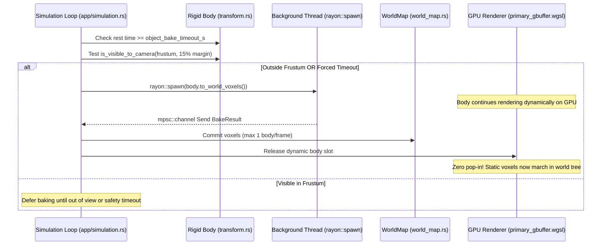

# Physics, Structural Islands & Rigid Body Dynamics Architecture

## Overview
Arcadia provides real-time structural collapse and dynamic voxel physics inspired by *Teardown*. It couples bitwise flood-fill topological island detection with a 6-DOF rigid body physics solver supporting compound convex sub-boxes, Box3D-style multi-point contact manifolds, and an asynchronous resting body rasterization pipeline that bakes static rubble back into the world tree with zero pop-in.

---

## 1. Structural Island Detection (*Teardown*-Style Collapse)

When world geometry is severed by spherical carving, explosives, or mining, disconnected floating geometry must collapse into physical dynamic bodies while grounded structures remain stable.

```mermaid
flowchart TD
    A[Voxel Carve Event] --> B[Perimeter Shell Sampling<br/><code>r in [R, R + 2.5 voxels]</code>]
    B --> C{Bedrock Anchor Probed?<br/><code>y <= 4</code> or <code>MAT_BEDROCK</code>}
    C -- Yes --> D[Instant Short-Circuit: Grounded]
    C -- No --> E[2D Surface Shell Flood-Fill<br/><code>O(N^2)</code> Boundary Traversal]
    E --> F{Mass Exceeds <code>max_island_voxels</code><br/>or Depth > <code>max_depth_v</code>?}
    F -- Yes --> D
    F -- No --> G[Closed Boundary Shell Confirmed]
    G --> H[Interior Voxel Fill & Extraction]
    H --> I{Voxel Count <= 8?}
    I -- Yes --> J[Convert to Debris Particle Cubes<br/>6.25cm physical cubes]
    I -- No --> K[Synthesize 6-DOF Dynamic RigidVoxelBody]
```

### 1.1 Targeted Perimeter-Seeded Island Detection (`crates/arcadia-world/src/islands/perimeter.rs`)
- **Crater Perimeter Sampling:** Collects solid voxels strictly within the spherical shell bordering destroyed space ($r \in [R, R + 2.5\text{ voxels}]$) and initiates 6-connected graph traversals outward from each connected perimeter patch.
- **Bedrock Anchoring & Instant Short-Circuit:**
  - Bedrock ($y \le 4$ voxels = $0.25\text{m}$) and `MAT_BEDROCK` are strictly unyielding ground anchors.
  - Traversal short-circuits immediately upon reaching an anchor, or when visited voxel count exceeds `max_island_voxels` (default 32,768) or probe depth exceeds `max_depth_v` (default 12.0m). Massive cliffs and buildings resolve as grounded in $<0.1\text{ ms}$.
- **Causality & Local Scope:** Only structures topologically connected through the carved crater are investigated. Intact bridges, archways, and ceilings $2\text{m}$ away are never spuriously analyzed or collapsed.
- **2D Boundary Surface Shell Traversal ($O(N^2)$ Surface vs. $O(N^3)$ Interior Volume):**
  - Explots the topological property that any detached solid island has a closed 2D boundary shell ($O(N^2)$ surface area $A \propto V^{2/3}$ vs. $O(N^3)$ interior volume).
  - Traversal advances exclusively along boundary voxels (`solid_mask & neighbor_air_mask`), skipping millions of internal solid rock voxels in large cliffs. Interior voxels are gathered only once a closed detached shell is confirmed.
- **Crater Rim Crumb Cleanup:**
  - Floating fragments $\le 8$ voxels (`SMALL_ISLAND_PARTICLE_MAX_VOXELS`) are converted directly into physical $6.25\text{ cm}$ `DebrisParticle` cubes with outward blast velocities.
  - Fragments $> 8$ voxels instantiate dynamic `RigidVoxelBody` instances.

### 1.2 Bitwise Macro-Brick Support Propagation (`crates/arcadia-world/src/islands/connectivity.rs`, `bitwise.rs`)
- **64-Bit Intra-Brick Dilations:** Uses bit-shift primitives (`dilate_brick_step`, `dilate_support_brick_step`, `flood_fill_brick_u64`) to dilate 6-connected components within $4^3$ Leaf Bricks in single clock cycles.
- **6-Way Compressive Support:** Propagates support in all 6 directions ($\pm X, \pm Y, \pm Z$, including downward $-Y$), removing artificial cantilever cutoff limits so arches, staircases, and sloped vaults remain structurally stable.

---

## 2. 6-DOF Dynamic Rigid Voxel Physics (`crates/arcadia-physics/src/rigid_voxel/`)

Detached voxel geometry is simulated as an oriented bounding box (OBB) 6-DOF rigid body with true volume distribution and compound collision geometry.

### 2.1 Center of Mass & Discrete Inertia Tensor (`construction.rs`)
Each solid voxel of mass $m_i = \rho \cdot s^3$ at local position $\vec{r}_i$ contributes to the total mass $M$, center of mass $\vec{C}$, and moment of inertia tensor $\mathbf{I}$:

$$M = \sum_i m_i, \quad \vec{C} = \frac{1}{M} \sum_i m_i \vec{r}_i$$

The discrete $3 \times 3$ moment of inertia tensor about the center of mass includes the $\frac{s^2}{6}$ parallel-axis correction for finite cubic voxels:

$$\mathbf{I}_{xx} = \sum_i m_i \left[ (y_i - C_y)^2 + (z_i - C_z)^2 + \frac{s^2}{6} \right]$$

$$\mathbf{I}_{xy} = -\sum_i m_i (x_i - C_x)(y_i - C_y)$$

Where $s = 0.0625\text{ m}$. Inverting $\mathbf{I}$ yields the inverse inertia tensor $\mathbf{I}^{-1}$ used for rotational impulse equations.

### 2.2 Compound 3D Greedy Collider Synthesis (`collision/compound.rs`)
To eliminate the expense of checking thousands of individual voxels during collision:
1. **Greedy Decomposition:** Merges adjacent solid voxels into disjoint maximal solid cuboids (`VoxelSubBox`).
2. **Exposed-Face Bitmasks (`FACE_NEG_X` .. `FACE_POS_Z`):** Tracks which of the 6 faces are exposed to air. Internal seams between sub-boxes are flagged and culled during Separating Axis Theorem (SAT) tests, eradicating phantom edge snagging and contact jitter.
3. **Flat Local BVH (`SubBoxBvhNode`):** Sub-boxes are organized into a flat AABB bounding volume hierarchy with median splits along the largest coordinate axis for $O(\log K)$ collision queries.

### 2.3 Box3D-Style Multi-Point Contact Manifolds & Concave Interlocking (`collision/manifold.rs`)
- **15-Axis SAT Broadphase & Narrowphase:** Tests 3 face normals of Body A, 3 face normals of Body B, and 9 cross products of edge directions. Incorporates a 5% bias toward face contacts to favor face-to-face resting stability.
- **Sutherland-Hodgman Polygon Clipping:** Clips incident faces against reference face planes with $3\text{ mm}$ slop, followed by optimal 4-point quad contact reduction maximizing 2D contact area.
- **Concave Multi-Manifold Clustering:**
  - Up to 4 directional contact manifolds per body pair (`MAX_MANIFOLDS_PER_PAIR = 4`, $\cos \theta \ge 0.85$).
  - Enables true concave interlocking (arches resting on pillars, bowls, crossed fluted columns) without synthetic bounding volume expansion.
- **Branchless $C^\infty$-Smooth Orthonormal Basis:** Generates tangent vectors using Duff et al. (JCGT 2017) to prevent gimbal singularity artifacts in friction cones.

### 2.4 Static Terrain & Bedrock Narrowphase (`collision/terrain.rs`)
- **Bedrock Plane:** Analytic infinite plane at $y \le 0.3125\text{m}$.
- **Neighbor Brick Caching:** Uses `NeighborBrickCache` to evaluate exposed static world faces.
- **Contact Clustering:** Clusters terrain contacts into up to 8 normal clusters with up to 8 points per cluster.
- **Fluid Submersion & Buoyancy:** Calculates volume-weighted water submersion with buoyancy acceleration ($18 \frac{\rho_w}{\rho_b}$) and quadratic hydrodynamic drag ($1.5v + 0.8v^2$).

### 2.5 Impulse Solver, Stacking Stability & Island Sleeping (`solver.rs`)
- **Symplectic Euler Integration:** Runs 4 to 12 adaptive substeps per frame ($sub\_dt \le 4.2\text{ ms}$).
- **Contact Caching & Warm-Starting:** Matches contacts with previous frames ($< 35\text{ mm}$ displacement), scaling accumulated normal and 2D tangent impulses by $\alpha = 0.80$ to preserve stacking stability.
- **DAG Support Level Graph & Shock Passes:**
  - Organizes contact manifolds into a directed acyclic graph (DAG) bottom-up from bedrock and terrain.
  - Executes bottom-up velocity shock passes and split-impulse position shock passes (treating supporting bodies as having infinite mass during the pass) to eliminate stacking sponginess.
- **Split-Impulse Position Solver:**
  - Parameters: $\text{ERP} = 0.35$, shock $\text{ERP} = 0.55$, $\text{max step} = 25\text{ mm}$, sandwiched mass ratio cap $12.0$.
- **2D Support Polygon Stability & Island Sleeping:**
  - Resting bodies are grouped via Union-Find contact graph clustering.
  - Evaluates whether the center of mass projects inside the convex hull of resting contact points on the XZ plane (`is_com_stably_supported`) into `SupportSleepKind` (`StablePolygon`, `MultiCradled`, `SingleContact`, `None`).
  - Sleeping bodies wake instantly upon external kinetic impact or when supporting terrain/bodies are carved or shifted.
- **High-Energy Kinetic Impact Shattering:** Speeds $> 18\text{ m/s}$ shatter bodies $< 300$ voxels into physical GPU debris particles.

### 2.6 Kinematic Player-vs-Object Interaction (`arcadia-physics/src/character.rs`)
- Character AABB tests against rigid body compound colliders.
- Allows walking over fallen rubble, auto-stepping up 1..3 voxels ($6.25\text{cm}$ to $18.75\text{cm}$), and pushing dynamic bodies with impulses scaled by `body.inv_mass`.

### 2.7 GPU Dynamic OBB Ray Marching (`shaders/primary_gbuffer.wgsl`)
- Binds `array<RigidBodyInstance, 32>` at `@group(0) @binding(6)`.
- Transforms camera rays into body-local coordinates, marches the local CS64 tree hierarchy, and writes G-buffer hits with analytic 3D motion vectors computed from `prev_local_to_world` for temporal DLAA/TSR antialiasing.

---

## 3. Asynchronous Resting Rigid Body Baking Pipeline

When dozens of dynamic rigid bodies settle into static rubble, simulating them indefinitely incurs unnecessary physics and transform overhead. The baking pipeline transitions resting bodies into the static world tree seamlessly.



### 3.1 Frustum Visibility Gating (`transform.rs`, `app/simulation.rs`)
- Bodies resting for $t \ge \text{object\_bake\_timeout\_s}$ (configurable 5..180s, default 45s) evaluate camera frustum visibility (`is_visible_to_camera`) with a 15% peripheral guard margin and 150m cutoff distance.
- A resting body only bakes if it is **outside the camera frustum** OR if its rest duration exceeds a forced safety timeout ($3 \times \text{bake\_timeout}$).

### 3.2 Multi-Threaded Background Rasterization (`rayon::spawn`)
- Off-screen resting bodies are dispatched to background threads via `rayon::spawn`.
- Thread rasterizes rotated body voxels into global integer coordinates (`body.to_world_voxels()`) and transmits results via `mpsc::channel` (`BakeResult`).

### 3.3 Time-Sliced Main-Thread Commits & Zero Pop-In
- The simulation loop consumes **at most 1 bake completion per frame**, committing voxels into the static world (`world.set_voxels_global`) with minimal frametime impact.
- Baking bodies continue rendering dynamically on the GPU until the exact frame their static voxels commit, completely eliminating visual pop-in or disappearing rubble.
- Baking bodies are immune to dynamic capacity eviction.

---

## Related Specifications & Implementation Files
- **Storage & In-Place Edits:** [01_storage_and_memory.md](01_storage_and_memory.md)
- **Rendering & Shaders:** [02_rendering_and_lighting.md](02_rendering_and_lighting.md)
- **Physics Optimization Plan:** [rigid_body_physics_optimization_plan.md](../plans/rigid_body_physics_optimization_plan.md)
- **Master Entry Point:** [ARCHITECTURE.md](../../ARCHITECTURE.md)
- **Source Code:**
  - Islands detection: [`crates/arcadia-world/src/islands/`](../../crates/arcadia-world/src/islands/)
  - Character controller: [`crates/arcadia-physics/src/character.rs`](../../crates/arcadia-physics/src/character.rs)
  - Rigid body physics: [`crates/arcadia-physics/src/rigid_voxel/`](../../crates/arcadia-physics/src/rigid_voxel/)
  - Simulation loop: [`crates/arcadia-app/src/app/simulation.rs`](../../crates/arcadia-app/src/app/simulation.rs)

