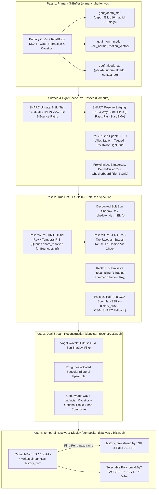

# Category C Advanced Lighting & Optics: Technical Feasibility & Architecture Plan

This document provides the benchmark-calibrated feasibility evaluation, algorithmic critique, and production-ready implementation architectures for items **C1–C5** (plus **F3** indirect tile dispatch) from [ROADMAP_AND_TODO.md](ROADMAP_AND_TODO.md#L130-L166), tailored to the Arcadia CS64 ($6.25\text{ cm}$) sparse voxel pipeline documented in [ARCHITECTURE.md](../../ARCHITECTURE.md) and standard `wgpu 23.0` (`wgpu::Features::empty()`, 32-bit WGSL atomics only).

---

## 1. Executive Summary & Benchmark-Calibrated Hardware Tier Strategy

The Arcadia voxel engine targets two distinct hardware envelopes, calibrated against empirical measurements in [benchmark_report.md](../../benchmark_report.md) (`18.83 ms` / `52.5 FPS` baseline at 1080p on integrated Radeon graphics; $\approx 0.05\text{ ms}$ per $1,000$ incoherent CS64 octree rays on Tier 1):

- **Tier 1 (Integrated GPUs / Low Power — e.g., AMD Radeon 660M/780M, Steam Deck):** Strict shared-DDR5 bandwidth and ALU ceiling (6–12 CUs). Cannot afford blind 3D volume ray sweeps ($>25,000$ extra incoherent rays/frame tanks frame rate). Relies on half-rate checkerboarding, view-seeded $O(N^2)$ surface caching (`8,160` tile paths/frame), short secondary bounce distances (`8–10 m`), and analytical approximations.
- **Tier 2 (Dedicated Desktop GPUs — e.g., RTX 3060+, RX 6700+):** High VRAM bandwidth and CU count. Supports full-rate ReSTIR GI/DI resampling, `32,400` SHARC surface paths/frame, half-res GGX glossy reflections, and depth-culled checkerboard froxel god rays.

| Feature | Initial / Legacy Conception | Fatal Bottlenecks / Empirical Pitfalls | Upgraded Production Architecture | Tier 1 (Integrated) Feasibility | Tier 2 (Desktop) Feasibility |
| :--- | :--- | :--- | :--- | :--- | :--- |
| **C0. Sky Bounce & Ambient Calibration** | `sky_amb` multiplied by `sun_vis` / `denoised_shadow`; high flat `min_ambient` | Shaded outdoor walls emit **zero** sky bounce into caves; high `min_ambient` drowns real multi-bounce GI. | Decouple sky hemisphere ambient from direct sun shadow; cut flat `min_ambient` by $75\%$ once SHARC is active. | **Yes ($0.00\text{ ms}$)** | **Yes ($0.00\text{ ms}$)** |
| **C5. True ReSTIR GI + SHARC Surface Cache** | Eulerian $64\times32\times64$ L1 SH Voxel Radiance Cache (VRC) + EMA blur | **VRC failed empirically (`+19.4 ms` on Radeon iGPU)** due to `393k` incoherent volume rays, solid-cell `0.0` trilinear dark grids, $6.25\text{ cm}$ wall leaks, and L1 SH ringing. | **4-Way Set-Associative Voxel-Surfel Hash (SHARC)** (`131k` slots, single-word 32-bit CAS, face-normal keyed, `4.5 MB`) + **True ReSTIR GI** (32 B reservoir, RIS + Jacobian spatial reuse, 0 extra VRAM ping-pong). | **Yes ($\approx 0.6\text{--}0.9\text{ ms}$, `8.1k` paths)** | **Yes ($\approx 0.3\text{--}0.5\text{ ms}$, `32.4k` paths)** |
| **C1. ReSTIR DI** | $16^3$ macro-cell power grid + rejection search for active voxels + 16 candidates | Rejection sampling in sparse macro-cells causes catastrophic SIMD divergence; shadow rays self-occlude on solid emissive voxels. | **Contiguous Emissive Pool + CPU Vose Alias Table + Tagged ReGIR Grid** + emitter-radius shadow trim & post-visibility reservoir zeroing. | **Yes ($\approx 1.0\text{--}1.2\text{ ms}$, checkerboard)** | **Yes ($\approx 0.5\text{--}0.7\text{ ms}$, full-rate)** |
| **C2. Glossy Reflections** | Inline raymarching in Pass 1 G-Buffer (`MAT_MIRROR_CHROME` only) | Tracing rough reflections in Pass 1 breaks SIMD coherence and shades unlit geometry; `prev_lit_color` & Hi-Z do not exist. | **Decoupled Half-Res Specular Pass**: Stride-doubling SSR on compact G-buffer reading `history_prev` via motion vector + CS64 Ray-Cone & **SHARC** off-screen shading. | **Mirror / Low-Roughness ($\approx 0.8\text{ ms}$)** | **Full GGX Glossy ($\approx 1.2\text{ ms}$)** |
| **C3. Volumetrics & Caustics** | 16 shadow-tested steps/px (`33.1M` rays) or unculled `921k` froxel rays/frame | `33.1M` rays $>300\text{ ms}$; even `921k` unculled CS64 froxel rays cost `4–8 ms` on Desktop. | **Analytical Wave-Laplacian Caustics** (All Tiers, `0` rays) + **Depth-Culled $2\times2$ Checkerboard Froxel Grid** (`~45k` meso-LOD rays, Desktop). | **Caustics Active ($<0.05\text{ ms}$)**; Froxels Off | **Caustics + Froxel Shafts ($\approx 0.7\text{ ms}$)** |
| **C4. Polynomial AgX** | Narkowicz ACES curve only (`composite_dlaa.wgsl`) | High-energy emissive lava/crystals clip chrominance toward harsh yellow/cyan. | **Selectable Polynomial AgX Display Transform** (Rec.2020 inset + sigmoid + chroma white-rotation) in Pass 4. | **Yes ($<0.02\text{ ms}$)** | **Yes ($<0.02\text{ ms}$)** |

---

## 2. Deep-Dive: C5 (Revised). True ReSTIR GI + SHARC Voxel-Surfel Cache

### 2.1 Post-Mortem: Why the Eulerian 3D Voxel Radiance Cache (VRC) Was Rejected

An Eulerian $64 \times 32 \times 64$ ($1\text{ m}$) L1 Spherical Harmonics clipmap was prototyped and benchmarked on integrated Radeon hardware. **Do not resurrect the Eulerian air-grid VRC approach.** It suffered from four fundamental failures in a $6.25\text{ cm}$ CS64 voxel engine:

1. **Catastrophic Ray Overhead (`+19.4 ms/frame`, $52.5 \to 26.0\text{ FPS}$):** Updating $1/8\text{th}$ of the volume ($16,384$ cells) $\times 8$ spherical Fibonacci rays + sun/point shadow rays launched up to **$393,216$ incoherent 3D octree rays every frame**—wasting $\sim 80\%$ of compute in empty sky air far above surfaces while thrashing GPU L1/L2 caches.
2. **Hardware Trilinear Zero-Bleed vs. Thin-Wall Leaking Contradiction:** Hardware `FilterMode::Linear` (`textureSampleLevel`) cannot mask individual occluded corners of a $2\times2\times2$ probe cell. Writing `0.0` to solid stone cells caused hardware trilinear filtering to pull surface irradiance toward black whenever a surface fell near an integer meter boundary (**1-meter dark shadow grids/halos**), while unmasked air probes bled bright outdoor sunlight straight through $6.25\text{ cm}$ cave walls.
3. **L1 SH Ringing & Chromatic Shift:** Projecting high-contrast directional sunlight into unwindowed L1 SH produced negative lobes opposite the sun; per-channel `max(vec3(0.0), ...)` clipping distorted shadow hues.
4. **Drowned Bounce-2 Signal & Non-ReSTIR Pass 2:** Attaching a radiance cache solely to Bounce 2 (`~0.7%` of direct sun energy after $\text{albedo}^2 / \pi$) was visually invisible beneath Pass 3's flat `min_ambient` floor, while `lighting_restir_gi.wgsl` was acting as a 1-spp EMA + 8-tap bilateral blur rather than true RIS/Jacobian ReSTIR GI.

---

### 2.2 Prerequisite C0: Sky-Bounce Bug Fix & Ambient Floor Calibration

Before multi-bounce GI can produce visible subterranean light transport, two shader defects in the current baseline must be corrected:

1. **Ungate Sky Hemisphere Bounce from Direct Sun Shadow:**
   - In [lighting_restir_gi.wgsl](../../shaders/lighting_restir_gi.wgsl#L327-L333), `bounce_sky_amb` is currently gated inside `if (b_ndl > 0.001) { if (bounce_sun_vis > 0.001) }`, and in [denoiser_reconstruct.wgsl](../../shaders/denoiser_reconstruct.wgsl#L234), `day_sky_amb` is multiplied by `denoised_shadow`. Consequently, shaded outdoor canyon walls under wide-open blue sky bounce **zero** sky radiance into cave entrances.
   - **Fix:** Once SHARC is active at secondary hits, remove the synthetic `bounce_sky_amb * bounce_sun_vis` term completely—SHARC's hemisphere rays on shaded outdoor walls naturally escape to the sky dome and cache true sky-occluded blue irradiance on those walls! In Pass 3, remove `day_sky_amb * denoised_shadow` (since Pass 2 ReSTIR GI already integrates sky-escaping hemisphere rays) and lower [`min_ambient`](../../shaders/denoiser_reconstruct.wgsl#L240) by $75\%$ to a minimal visibility safety floor (`0.003 * contact_ao`).

---

### 2.3 Upgraded Multi-Bounce Architecture: Voxel-Surfel SHARC (`wgpu 23.0` Lock-Free Hash)

Instead of an $O(N^3)$ air grid, Arcadia adopts a **Voxel-Surfel Spatially Hashed Radiance Cache (SHARC)** inspired by Frostbite GIBS (surface-bound surfels) and NVIDIA SHARC—exploiting the fact that CS64 voxel geometry *already* lies on an axis-aligned grid with 6 cardinal face normals ($\pm X, \pm Y, \pm Z$), eliminating 90% of triangle-mesh GIBS complexity (no disc spawning, no gap-filling passes, no cell-to-surfel linked lists).

```
┌────────────────────────────────────────────────────────────────────────┐
│ 1. SHARC UPDATE PASS (`sharc_update.wgsl` — View-Seeded Tile Paths)    │
│    • Tier 1 (iGPU): 1 jittered px per 16×16 tile (8,160 paths/frame)   │
│    • Tier 2 (Desktop): 1 jittered px per 8×8 tile (32,400 paths/frame) │
│    • Starts at Pass 1 G-Buffer hit (x_0, n_0) -> 0 primary ray cost!   │
│    • Traces 1 bounce to (x_1, n_1) + 1 sun shadow ray at (x_1, n_1)    │
│      (16.3k rays/frame Tier 1; 64.8k rays/frame Tier 2)                │
│    • Evaluates direct sun/sky at x_1, queries prev SHARC for bounce 2+,│
│      and deposits full outgoing diffuse radiance L_o(x_1) into (x_1,   │
│      n_1). (Primary visible hits (x_0, n_0) are lit directly by Pass 2/│
│      3, avoiding incomplete unlit cache entries at x_0).               │
└───────────────────────────────────┬────────────────────────────────────┘
                                    │
                                    ▼
┌────────────────────────────────────────────────────────────────────────┐
│ 2. SHARC RESOLVE & AGING PASS (`sharc_resolve.wgsl` — 0 Rays, <0.05ms) │
│    • 131,072 slots (32,768 4-way set-associative 64-byte buckets)      │
│    • Fast-start temporal EMA: α = 1.0 / min(sample_frames, 16.0)       │
│    • Evicts untouched surfels (`stale_age > 64`) -> auto-cleans carved │
│      or collapsed terrain without explicit CPU invalidation!           │
└───────────────────────────────────┬────────────────────────────────────┘
                                    │
                                    ▼
┌────────────────────────────────────────────────────────────────────────┐
│ 3. LOCK-FREE READS IN PASS 2 GI & PASS 2C SPECULAR (`query_sharc`)     │
│    • Read-only `storage, read` lookup (single 64-byte cache line!)     │
│    • Tangent-plane blue-noise sub-cell dither + fallback to unjittered │
│      anchor on miss dissolves cell seams without edge-speckling        │
│    • Supplies Bounce 2..∞ at ReSTIR GI hits & off-screen reflections   │
└────────────────────────────────────────────────────────────────────────┘
```

#### 1. Thin-Wall-Proof Voxel-Surfel Spatial Key
Given hit position $\mathbf{x}$ (meters), unit normal $\mathbf{n}$, and camera distance $d = \|\mathbf{x} - \mathbf{x}_{\text{cam}}\|$:

1. **Distance-Adaptive Cascade Scale (`lod` $\in \{0..3\}$):**
   $$s(\text{lod}) = 0.25 \cdot 2^{\text{lod}}\text{ m}, \quad \text{lod} = \text{clamp}\!\left(\left\lfloor \log_2\!\left(\frac{\max(d, 4.0)}{4.0}\right) \right\rfloor, \; 0, \; 3\right)$$
   - Near-field ($<8\text{ m}$): $0.25\text{ m}$ surfels (matches CS64 Leaf Bricks—crisp crevice bounce).
   - Mid/Far ($8\text{--}64\text{ m}+$): $0.5\text{ m} \to 1.0\text{ m} \to 2.0\text{ m}$ surfels (covers $128\text{ m}+$ vistas with no hard clipmap cutoff).
2. **Inward Voxel Anchor + Tangent Dither (on Query only):**
   - Snap $2\text{ cm}$ *into* the solid voxel behind the hit face so floating-point ray hits on integer voxel faces never flicker across cell boundaries:
     $$\mathbf{x}_{\text{anchor}} = \mathbf{x} - \mathbf{n} \cdot 0.02 + \mathbf{j}_{\text{tangent}} \cdot (0.42 \, s)$$
     *(Note: $\mathbf{j}_{\text{tangent}} = \mathbf{0}$ during `sharc_update` accumulation; blue-noise jittered in $[-1, 1]^2$ on the tangent plane during `query_sharc` reads to seamlessly dither cell boundaries).*
   - **Edge-Speckle Guardrail (Fallback to Unjittered Anchor):** On thin geometric features (e.g. 1-voxel fence/pole $< s$), tangent plane jitter can shift $\mathbf{x}_{\text{anchor}}$ into adjacent empty air where no surfels exist. If the jittered bucket lookup misses, `query_sharc` immediately falls back to re-probing the bucket using the unjittered anchor ($\mathbf{j}_{\text{tangent}} = \mathbf{0}$) before returning `0.0`, completely eliminating black speckles on thin voxel edges.
3. **Face-Normal Separation (`norm_id` $\in \{0..5\}$ for $\pm X, \pm Y, \pm Z$):**
   - Quantize $\mathbf{c} = \lfloor \mathbf{x}_{\text{anchor}} / s \rfloor + 16384$.
   - **Continuous Normal Dominant-Axis Mapping (Rigid Bodies):** For dynamic rigid bodies whose normals are continuous rather than axis-aligned, project to dominant face:
     ```wgsl
     let abs_n = abs(normal);
     var norm_id = 0u;
     if (abs_n.x > abs_n.y && abs_n.x > abs_n.z) {
         norm_id = select(1u, 0u, normal.x > 0.0);
     } else if (abs_n.y > abs_n.z) {
         norm_id = select(3u, 2u, normal.y > 0.0);
     } else {
         norm_id = select(5u, 4u, normal.z > 0.0);
     }
     ```
   - **Why $6.25\text{ cm}$ Wall Leaks Are Impossible:** The sunlit outer face of a $6.25\text{ cm}$ wall (`+X`, `norm_id = 0`) and the dark cave inner face of the *exact same voxel* (`-X`, `norm_id = 1`) share $\mathbf{c}$ but differ in `norm_id`, hashing to completely separate surfel entries.
4. **Single-Word 32-Bit Hash Key & Bucket Generation:**
   - 15-bit bucket index:
     `bucket = pcg_hash(u32(c.x) * 73856093u ^ u32(c.y) * 19349663u ^ u32(c.z) * 83492791u ^ norm_id * 2654435761u ^ lod * 38069u) & 32767u;`
   - 32-bit key signature (bit 31 = 1 guarantees `key != 0u`, reserving `0u` strictly for empty slots; includes all 3 spatial axes):
     `target_key = pcg_hash(bucket ^ (u32(c.x) * 1013904223u) ^ (u32(c.y) * 1664525u) ^ (u32(c.z) * 2891336453u) ^ (norm_id << 20u) ^ (lod << 24u)) | 0x80000000u;`
   - **Entropy & Collision Immunity:** 15 bits (bucket index) + 31 bits (independent key signature across X, Y, Z, normal, and LOD) = **46 bits of hash entropy**. The probability of a false key match across 131,072 surfels is $\approx 10^{-14}$ (zero collisions in practice).
   - **Cache Miss Fallback Contract:** If all 4 slots in `sharc_resolved[base .. base + 3]` fail to match `target_key` (after the unjittered fallback check), `query_sharc` returns `vec3<f32>(0.0)` (or minimal ambient floor). Pass 2 consumes `0.0` gracefully without division by zero.

#### 2. 100% Standard `wgpu 23.0` (`atomic<u32>`) 4-Way Set-Associative Table (`4.5 MB` Total VRAM)
Because `wgpu::Features::empty()` in [context.rs](../../crates/arcadia-render/src/context.rs#L78) provides only 32-bit integer atomics (`atomic<u32>`), SHARC uses **32,768 4-way set-associative buckets** (`131,072` total surfels):
- **Bucket Index:** Probing only the 4 slots `base .. base + 3` where `base = bucket * 4u`.
- **Why 4-Way Buckets Beat Linear Probing:**
  1. Evicting expired surfels (`stale_age > 64`) never orphans downstream linear-probe chains (zero tombstones required).
  2. Read-only `query_sharc` in Pass 2 fetches **at most one aligned 64-byte GPU L2 cache line** (`4 × 16 B`).
- **Race-Free Single-Word Slot Claiming:**
  Because the key fits in a single 32-bit `atomic<u32>`, slot claiming uses a standard single-word atomic compare-and-swap loop with **zero sentinels and zero memory-ordering hazards**:
  ```wgsl
  let base_slot = bucket * 4u;
  var claimed_slot = 0xFFFFFFFFu;
  for (var i = 0u; i < 4u; i = i + 1u) {
      let slot = base_slot + i;
      let res = atomicCompareExchangeWeak(&sharc_keys[slot], 0u, target_key);
      if (res.exchanged || res.old_value == target_key) {
          claimed_slot = slot;
          break; // Won empty slot or slot was already allocated to this surfel!
      }
  }
  ```
  *(Crucial Race Immunity: If two threads in the same or different workgroups concurrently claim a slot for the exact same surfel, whichever wins sets `target_key`; the second thread observes `res.old_value == target_key` and immediately reuses the same slot—completely preventing duplicate slot allocations without WebGPU store-ordering hazards).*
- **Storage Buffers (`4.5 MB` Total) & WebGPU Stage-Limit Protocol:**
  In WebGPU / `wgpu 23.0`, `max_storage_buffers_per_shader_stage` (default 8; 24–32+ on native discrete GPUs) applies **per shader stage across ALL bind groups combined**.
  To strictly conserve storage buffer slots in Pass 2 and prevent exceeding downlevel hardware limits:
  1. `sharc_keys: array<atomic<u32>, 131072>` (`512 KB` — 1 `atomic<u32>` key per slot, claimed via single-word CAS; bound as `var<storage, read_write>` strictly in `sharc_update.wgsl` and `sharc_resolve.wgsl`).
  2. `sharc_accum: array<atomic<u32>, 524288>` (`2.0 MB` — `[r_fixed, g_fixed, b_fixed, sample_count]` per slot, using fixed-point scale `1024.0` so `u32(clamp(L, 0.0, 32.0) * 1024.0)` accumulates up to $131,072$ hits/frame without `u32` overflow; bound as `var<storage, read_write>` strictly in `sharc_update.wgsl` and `sharc_resolve.wgsl`; cleared via `atomicStore`).
  3. `sharc_resolved: array<SharcResolvedSlot, 131072>` (`2.0 MB`, `16 B/slot`: `{ key: u32, rad_rg: u32, rad_b_meta: u32, pad: u32 }`; bound as `var<storage, read_write>` in `sharc_resolve.wgsl`, and **bound as `var<storage, read>` in Pass 2 GI and Pass 2C Specular**).
  
  **Pass 2 Storage Limit Guardrail:** Pass 2 ReSTIR GI and Pass 2C Specular **only read `sharc_resolved`**! They do NOT bind `sharc_keys` or `sharc_accum`. In Pass 2, `@group(2)` contains ONLY `sharc_resolved` (1 single storage buffer slot), protecting Pass 2 from exceeding stage buffer limits. (Additionally, Pass 2 does not simulate debris; `debris_pool` in `@group(0)` can be omitted from Pass 2's pipeline layout if downlevel limits require saving an extra slot).
- **WGSL Bit-Packing Guardrail (Features::empty()):**
  Because Arcadia runs with standard `Features::empty()` without native `f16` primitive language types, packing and unpacking `rad_b_meta` (`f16` blue radiance + `u8 hist_frames` + `u8 stale_age`) uses standard WGSL built-in `pack2x16float` + bit-shifts:
  ```wgsl
  // Packing in sharc_resolve.wgsl:
  let packed_f16 = pack2x16float(vec2<f32>(blue_radiance, 0.0)) & 0xFFFFu;
  let rad_b_meta = packed_f16 | (u32(hist_frames) << 16u) | (u32(stale_age) << 24u);

  // Unpacking in query_sharc (Pass 2):
  let blue_radiance = unpack2x16float(slot.rad_b_meta & 0xFFFFu).x;
  let hist_frames = (slot.rad_b_meta >> 16u) & 0xFFu;
  let stale_age = (slot.rad_b_meta >> 24u) & 0xFFu;
  ```

---

### 2.4 Upgrading `lighting_restir_gi.wgsl` to True ReSTIR GI (Ouyang et al. 2021)

With SHARC handling Bounce $2\dots\infty$, Pass 2 upgrades from a simple EMA + bilateral blur to **unbiased Resampled Importance Sampling (RIS) with Jacobian Spatial Reconnection**, while keeping **exact 32-byte `GiReservoir` parity** (`0 bytes` of extra VRAM bandwidth over current `Agent-A`).

#### 1. Zero-Overhead 32-Byte `GiReservoir` Layout
```wgsl
// GPU-SYNC: 32 bytes (identical footprint to legacy GiReservoir; 66.4 MB per buffer at 1080p, 132.8 MB ping-pong).
struct GiReservoir {
    // World-space secondary hit x_s (or x_v + bounce_dir * 500.0 when is_sky == 1)
    sample_pos: vec3<f32>,   // 12 B
    // [0..15]: snorm16 octahedral secondary normal n_s
    // [16..23]: M (u8 sample count, capped <= 16)
    // [24..30]: sample_age (u7 frames since path origin, invalidated > 12)
    // [31]: is_sky (1 bit)
    norm_m_flags: u32,       //  4 B
    // pack2x16float(Lo.r, Lo.g): outgoing radiance at x_s (excluding primary BRDF/cosine)
    lo_rg: u32,              //  4 B
    // pack2x16float(Lo.b, min(W, 65500.0)): Lo.b and clamped unbiased RIS weight W (guards against IEEE 754 f16 inf/NaN)
    lo_b_w: u32,             //  4 B
    // Linear ray distance `hit_dist` of the primary pixel (for exact 3D disocclusion check)
    primary_depth: f32,      //  4 B
    // pack2x16float(accum_sun_shadow, shadow_m): decoupled temporal sun-shadow EMA
    shadow_vis_m: u32,       //  4 B
};
```
*(WGSL Packing Guardrail: Because WGSL standard lacks `pack2x8snorm`, `norm_m_flags` packs the octahedral normal via explicit bit shifting: `let oct_u = vec2<u32>(clamp(vec2<i32>(oct * 127.0), vec2<i32>(-128), vec2<i32>(127)) + 128); let norm_m_flags = (oct_u.x & 0xFFu) | ((oct_u.y & 0xFFu) << 8u) | ((m & 0xFFu) << 16u) | ((sample_age & 0x7Fu) << 24u) | select(0u, 0x80000000u, is_sky);`).

*(Rust Alignment Guardrail: In Rust, `[f32; 3]` has 4-byte alignment, while WGSL `vec3<f32>` imposes 16-byte alignment on storage buffer structs. Any host-side Rust mirror struct for `GiReservoir` must be declared with `#[repr(C, align(16))]` to guarantee exact 32-byte stride parity without buffer upload mismatches).*

*(Uniform Buffer Guardrail: Add `prev_cam_pos: [f32; 4]` to `CameraUniforms` in [camera.rs](../../crates/arcadia-render/src/camera.rs) and [types.wgsl](../../shaders/common/types.wgsl), expanding uniform size from 400 to 416 bytes (cleanly 16-byte aligned). `gpu_pools.rs` automatically calculates buffer allocation size via `std::mem::size_of::<CameraUniforms>()`. In `renderer.rs`, `prepare_camera_uniforms` fills `prev_cam_pos` using `[self.prev_eye.x, self.prev_eye.y, self.prev_eye.z, 0.0]`, allowing temporal disocclusion to validate `abs(distance(prev_world_pos, u_cam.prev_cam_pos.xyz) - prev_res.primary_depth) < depth_tol` without wasting 12 reservoir bytes on primary world position).*

#### 2. Unit-Consistent RIS Target PDF & $\pi$-Cancellation
At primary visible surface $(\mathbf{x}_v, \mathbf{n}_v)$, initial bounce direction $\omega$ is drawn from the true cosine hemisphere $p(\omega) = \frac{\max(0, \mathbf{n}_v \cdot \omega)}{\pi}$ (tracing `8–10 m` on Tier 1, `16 m` on Tier 2, querying `query_sharc(x_s, n_s)` at the secondary hit for multi-bounce diffuse radiance $L_o(\mathbf{x}_s)$):

- **Target PDF at receiver $\mathbf{x}_v$:**
  $$\hat{p}_v(\mathbf{x}_s) = \text{luma}\!\big(L_o(\mathbf{x}_s)\big) \cdot \frac{\max(0.0, \; \mathbf{n}_v \cdot \omega_{v \to s})}{\pi}$$
- **Initial Candidate RIS Weight:**
  $$w_{\text{init}} = \frac{\hat{p}_v(\mathbf{x}_s)}{p(\omega)} = \text{luma}\!\big(L_o(\mathbf{x}_s)\big)$$
- **Final Shaded Diffuse Bounce (fed to Pass 3 before primary `albedo` multiply):**
  $$W = \frac{w_{\text{sum}}}{M \cdot \max(\hat{p}_v(\mathbf{x}_s), \; 10^{-3})}, \quad E_{\text{GI}}(\mathbf{x}_v) / \pi = L_o(\mathbf{x}_s) \cdot \frac{\max(0.0, \; \mathbf{n}_v \cdot \omega_{v \to s})}{\pi} \cdot \min(W, \; 65500.0)$$
  *(Verification: for $M=1$, $W = \frac{\pi}{\cos\theta_v}$, so $\frac{\cos\theta_v}{\pi} W = 1$ and $E_{\text{GI}}/\pi = L_o(\mathbf{x}_s)$—exact energy conservation with zero missing or duplicate $\pi$ factors. The explicit clamp $\min(W, 65500.0)$ and $10^{-3}$ epsilon prevent IEEE 754 `f16` overflow into `+infinity` and `NaN` fireflies at grazing angles or in dim regions).*

#### 3. Temporal & Spatial Reuse Guardrails (Anti-Boiling & Anti-Leak)
1. **Temporal M-Cap & Path Aging:** Clamp temporal `M <= 16` (`12` during active sculpting/destruction) and expire reservoirs with `sample_age > 12` frames so moving lights and carved cave openings converge in $<0.2\text{ s}$.
2. **Pre-Reconnection Bilateral Normal & Depth Reject:** Before evaluating the Jacobian or merging candidates, reject spatial candidates from neighbor $q$ if $\mathbf{n}_v \cdot \mathbf{n}_q < 0.80$ or $|d_v - d_q| / d_v > 0.10$. This prevents light bleeding across geometric silhouettes and avoids wasting coarse shadow visibility checks across unrelated scene depths.
3. **2–3 Tap Spatial Reuse Pass (`Pass 2B`) with Clamped Reconnection Jacobian:**
   Because each neighbor reservoir already carries up to 16 temporal samples, spatial reuse requires only **2 taps** (Tier 1) or **3 taps** (Tier 2) instead of 8. Reconnecting finite hit $(\mathbf{x}_s, \mathbf{n}_s)$ from neighbor $\mathbf{x}_q$ to pixel $\mathbf{x}_v$ (`is_sky == 0`) scales target density by the area-to-solid-angle Jacobian determinant:
   $$\mathbf{v}_{\text{new}} = \mathbf{x}_v - \mathbf{x}_s, \quad \mathbf{v}_{\text{old}} = \mathbf{x}_q - \mathbf{x}_s$$
   $$|J_{q \to v}| = \frac{\max(0.0, \; \mathbf{n}_s \cdot \hat{\mathbf{v}}_{\text{new}})}{\max(10^{-4}, \; \mathbf{n}_s \cdot \hat{\mathbf{v}}_{\text{old}})} \cdot \frac{\|\mathbf{v}_{\text{old}}\|^2}{\max(0.01, \; \|\mathbf{v}_{\text{new}}\|^2)}$$
   - **Firefly Guardrail:** Reject reconnection if $\|\mathbf{v}_{\text{new}}\| < 0.25\text{ m}$ or $\mathbf{n}_s \cdot \hat{\mathbf{v}}_{\text{new}} \le 0.05$; clamp $|J_{q \to v}| \in [0.1, \; 4.0]$. (For sky samples `is_sky == 1`, $|J_{q \to v}| = 1.0$).
4. **Corner-Leak Visibility Check:** When a spatial neighbor candidate wins over the pixel's temporal reservoir, trace **1 short coarse visibility ray** `trace_shadow_vis(x_v + n_v * 0.08, dir_v_to_s, dist_v_to_s - 0.12)`. If occluded, discard the spatial merge and retain the temporal reservoir—eliminating light bleeding around doorways and pillars.
5. **Two-Pass Execution & Fixed Buffer Role Protocol (Zero Extra VRAM):**
   Because GPU workgroups run concurrently without cross-workgroup memory barriers, spatial neighbor reuse of current-frame candidates CANNOT run inside the same compute dispatch as Pass 2A. Instead, Pass 2 executes as two separate compute passes in [renderer.rs](../../crates/arcadia-render/src/renderer.rs) reusing the existing `reservoir_a_buf` and `reservoir_b_buf` buffers with **fixed, non-toggling roles**:
   - **Permanent Buffer Roles (Constant across all frames — eliminating frame-to-frame `ping_pong = (frame_index & 1)` toggle for reservoirs):**
     - `reservoir_a_buf` is permanently the **History & Final Output Buffer**.
     - `reservoir_b_buf` is permanently the **Intermediate Temporal Scratch Buffer**.
   - **Pass 2A (Temporal RIS):** Reads `reservoir_a_buf` (Frame $N-1$ final state) and writes temporal candidates to `reservoir_b_buf`.
   - **Pass 2B (Spatial Reuse):** Reads current-frame candidates from `reservoir_b_buf` and writes spatially resampled candidates back into `reservoir_a_buf` (which is dead for Frame $N$).
   - **Pass 3 (Denoiser Reconstruct):** Reads `reservoir_a_buf` (which now holds Frame $N$'s final resampled candidates).
   - **Next Frame ($N+1$):** Pass 2A again reads `reservoir_a_buf` (Frame $N$ final state) and writes to `reservoir_b_buf`.
   This cleanly eliminates read-after-write races, prevents intermediate scratch data leakage into Pass 3, and requires zero additional reservoir buffers.

---

## 3. Deep-Dive: C1. Multi-Candidate ReSTIR DI for Dynamic Emissives

### 3.1 Algorithmic Critique of Roadmap Design
The initial roadmap specifies a two-level $16^3$ macro-cell power grid with random active-voxel picking inside selected cells.
- **The Empty-Voxel Divergence Trap:** A $16^3$ cell holds $4,096$ micro-voxels. If 1 torch occupies the cell, $4,095/4,096$ random picks hit air or stone, stalling 32/64-wide GPU wavefronts.

### 3.2 Upgraded Architecture: Contiguous Light Pool + CPU Alias Table + Tagged ReGIR Grid

```
┌────────────────────────────────────────────────────────────────────────┐
│ 1. COMPACT EMISSIVE POOL + VOSE ALIAS TABLE (CPU Upload on Chunk Edit) │
│    • Maintained by CPU EmissiveRegistry in `arcadia-world`/`-core`     │
│    • EmissiveSource[16384] (512 KB) + AliasEntry[16384] (128 KB)       │
│    • Built in O(N) (<0.1 ms) on CPU only when chunks mutate            │
└───────────────────────────────────┬────────────────────────────────────┘
                                    │
                                    ▼
┌────────────────────────────────────────────────────────────────────────┐
│ 2. TAGGED ReGIR SPATIAL GRID (`regir_update.wgsl`: ~0.08 ms)           │
│    • 32 × 16 × 32 world cells (4m³ around camera; 16,384 cells)        │
│    • Amortized 1/4 cells/frame: draws 16 O(1) Alias proposals -> 4 RIS │
│    • Stores explicit `cell_world_id` tag to prevent toroidal wrap bugs │
└───────────────────────────────────┬────────────────────────────────────┘
                                    │
                                    ▼
┌────────────────────────────────────────────────────────────────────────┐
│ 3. SCREEN-SPACE ReSTIR DI (Integrated into Pass 2A/2B Pipeline)        │
│    • Pass 2A: Temporal DI evaluated alongside Temporal GI RIS          │
│    • Pass 2B: Spatial DI evaluated alongside Spatial GI Reuse          │
│    • Evaluates 4 local ReGIR slots + 2 O(1) global Alias samples       │
│    • 1 radius-trimmed shadow ray + post-visibility zeroing             │
└────────────────────────────────────────────────────────────────────────┘
```

#### Reservoir Data Structure (16 bytes):
```wgsl
struct DiReservoir {
    // [0..15]: light_idx (0..16383), [16..31]: deterministic sub-cluster jitter seed
    light_idx_seed: u32,
    w_sum: f32,
    m: f32,
    w: f32,
};
```
*(VRAM Footprint: At full 1080p ($1920 \times 1080$), 16 bytes/pixel equals $33.2\text{ MB}$ per buffer, totaling $66.4\text{ MB}$ for the ping-pong pair. For Tier 1 integrated graphics and Steam Deck where DDR5 bandwidth is shared, ReSTIR DI is evaluated at half-resolution $960 \times 540$ requiring only $8.3\text{ MB}$ per buffer / $16.6\text{ MB}$ ping-pong, or runs with 50% checkerboard ray skipping).*

### 3.3 Critical Arcadia CS64 Guardrails for ReSTIR DI

1. **CPU Emissive Registry Prerequisite (`arcadia-world` & `arcadia-core`):**
   - Arcadia's material palette specifies `emission_meta`, but the engine previously lacked an active world-space registry of placed emissive voxels.
   - When chunks are generated or edited via `arcadia-core` and `arcadia-world`, an active `EmissiveRegistry` tracks all voxels with non-zero emission and clusters contiguous Level-2 Meso-Nodes ($1\text{ m}^3$). On chunk edits, it builds the 128 KB Vose Alias Table (`struct AliasEntry { prob: f32, alias_idx: u32 }`) proportional to radiant flux $\Phi_i$ in $O(N)$ (`< 0.1 ms`), letting ReGIR and screen passes draw flux-weighted global candidates in **1 array read**.
2. **Solid Emissive Voxel Self-Occlusion Guardrail (Critical!):**
   - Unlike non-physical point lights floating in `MAT_AIR`, Arcadia's glowing crystals, runes, and lava are **solid voxels inside the CS64 octree**. Tracing `trace_shadow_vis` to full distance $d = \|\mathbf{y} - \mathbf{x}\|$ will strike the emissive voxel's own outer face and return `vis = 0.0`!
   - **Rule:** Trim shadow ray max distance by the emitter's bounding radius: `shadow_max_d = max(0.02, d - max(r_e, 0.09))`.
3. **Meso-Cluster Surface Centroids (Preventing Sub-Lava Rock Occlusion):**
   - For large lava pools/slabs clustered at Level-2 Meso-Nodes ($1\text{ m}^3$), **do not** set $\mathbf{y}$ to the $1\text{ m}^3$ box center or jitter uniformly in 3D—if a $6.25\text{ cm}$ lava sheet rests on $93.75\text{ cm}$ of solid basalt inside that $1\text{ m}^3$ node, 3D volume jitter places $94\%$ of light samples *inside solid rock*!
   - Instead, CPU clustering computes the **exposed emissive micro-voxel centroid and dominant face normal**, jittering tangent to the exposed surface using the deterministic `u16` seed packed in `light_idx_seed`.
4. **Post-Visibility Reservoir Zeroing & Explicit Toroidal Cell Tags:**
   - After casting the winning shadow ray, if `vis == 0.0`, immediately set `res.w = 0.0; res.w_sum = 0.0;` before writing `di_reservoir_curr` so bright lights occluded behind walls never dominate neighbor `w_sum` ("dark-halo boiling").
   - Each ReGIR cell stores its integer `cell_world_coord` tag; if `stored_coord != current_cell_coord`, history is discarded immediately—making toroidal wrapping artifacts impossible.

---

## 4. Deep-Dive: C2. Decoupled Glossy Reflections & GGX Importance Sampling

### 4.1 Algorithmic Critique & Actual Engine Buffer Alignment
In [primary_gbuffer.wgsl](../../shaders/primary_gbuffer.wgsl#L232-L293), ideal mirror reflections (`MAT_MIRROR_CHROME`) are currently traced inline inside Pass 1, overwriting `albedo` with reflected light and relying on a special-case branch in [denoiser_reconstruct.wgsl](../../shaders/denoiser_reconstruct.wgsl#L256-L260). Expanding inline tracing to rough glossy materials ($40\text{--}70\%$ screen coverage) would cripple Pass 1 SIMD coherence and shade unlit geometry.
*(Note: Translucent `MAT_WATER_CRYSTAL` refraction remains in Pass 1; only opaque specular/mirror reflection moves to Pass 2C).*

Furthermore, the specular pass must align with Arcadia's **actual** G-Buffer and TSR buffers:
- [primary_gbuffer.wgsl](../../shaders/primary_gbuffer.wgsl) packs the compact 20 B/px G-Buffer (`gbuf_depth_mat`, `gbuf_norm_motion`, `gbuf_albedo_ao`). Motion vector is in `gbuf_norm_motion.y` (FP16 `motion = prev_uv - pixel_uv`), and there is no hardware Hi-Z pyramid or `prev_lit_color` buffer—instead, Pass 4 ([composite_dlaa.wgsl](../../shaders/composite_dlaa.wgsl#L6-L7)) already maintains **`history_prev`**, a full-resolution temporally anti-aliased **linear HDR** scene buffer!

### 4.2 Upgraded Architecture: Half-Res Specular Pass (`history_prev` SSR + CS64/SHARC Fallback)

```
┌────────────────────────────────────────────────────────────────────────┐
│ PASS 1: PRIMARY G-BUFFER (`primary_gbuffer.wgsl`)                      │
│ • Write compact 20 B/px G-Buffer: depth_mat, norm_motion, albedo_ao     │
│ • REMOVE inline `MAT_MIRROR_CHROME` raymarch (water refraction stays); │
│   all materials write true albedo and roughness into G-Buffer!         │
└───────────────────────────────────┬────────────────────────────────────┘
                                    │
                                    ▼
┌────────────────────────────────────────────────────────────────────────┐
│ PASS 2C: HALF-RES SPECULAR PASS (`specular_trace.wgsl`, 960×540)       │
│ For quads with roughness < 0.50 (1 jittered ray per 2×2 quad):         │
│   • Sample GGX VNDF microfacet half-vector h -> r = reflect(-v, h)     │
│   • Step 1 (Screen-Space Ray March): 14 stride-doubling steps against  │
│     `gbuf_depth_mat` depth with thickness threshold `max(0.12, 0.05*hit_d)`. │
│     On hit at `q`, reconstruct `uv_prev = q_uv + motion` and sample   │
│     HDR radiance from TSR `history_prev` (using manual 4-tap bilinear  │
│     filtering matching `sample_history_bilinear` in Pass 4)!           │
│   • Step 2 (CS64 + Rigid Body Ray-Cone Fallback on SSR Miss):          │
│     w_cone(t) = w_0 + 2*t*α -> terminates at Level-2 Meso `lod_payload`│
│     when w_cone >= 0.25m, and shades indirect bounce in O(1) via       │
│     `query_sharc(refl_hit.hit_pos_meters, refl_hit.normal)`!           │
└───────────────────────────────────┬────────────────────────────────────┘
                                    │
                                    ▼
┌────────────────────────────────────────────────────────────────────────┐
│ PASS 3: DUAL-STREAM RECONSTRUCTION (`denoiser_reconstruct.wgsl`)       │
│ • Stream A: Diffuse GI filtered with Vogel plane/stair edge-stopping   │
│ • Stream B: Specular cross-bilateral upsample & roughness-scaled       │
│             kernel: σ_spec = base_radius * sqrt(roughness)             │
│ • Unified PBR Composite: `albedo * diffuse + specular` (removes the    │
│   legacy chrome special-case branch)!                                  │
└────────────────────────────────────────────────────────────────────────┘
```

#### Why Pairing C2 with SHARC Is a Massive Win:
Whenever a reflection ray misses screen space (e.g., a mirror or wet temple floor reflecting the ceiling or cave behind the camera), `history_prev` has no off-screen pixels. Querying **`query_sharc(refl_hit.hit_pos_meters, refl_hit.normal)`** shades off-screen reflected interiors with full multi-bounce cave/emissive lighting in **one 64-byte hash lookup and zero extra bounce rays**.

#### Ping-Pong Bind Group Contract for Pass 2C:
In [renderer.rs](../../crates/arcadia-render/src/renderer.rs), Pass 4 ping-pongs between `history_a_buf` and `history_b_buf` via `ping_pong = (frame_index & 1)`. Because Pass 2C executes *before* Pass 4 in the frame, Pass 2C must bind whichever buffer holds the finished output from frame $N-1$:
- In [gbuffer.rs](../../crates/arcadia-render/src/gbuffer.rs), allocate `pass2c_bind_groups: [wgpu::BindGroup; 2]`:
  - `pass2c_bind_groups[0]` binds `history_a_buf` as `history_prev`.
  - `pass2c_bind_groups[1]` binds `history_b_buf` as `history_prev`.
- Pass 2C binds `pass2c_bind_groups[ping_pong]`, ensuring 100% race-free reads of previous-frame linear HDR pixels without extra copies.
- The output `specular_buf` is strictly half-resolution ($960 \times 540$, $4.15\text{ MB}$ packed `vec2<u32>` holding `f16x2` RG and BA). Crisp mirror reflections on $\alpha < 0.04$ surfaces are reconstructed without SIMD quad divergence through Pass 3's normal/depth-guided cross-bilateral upsampling, followed by Pass 4's Catmull-Rom TSR temporal accumulation across jittered frames.

---

## 5. Deep-Dive: C3 & C4. Depth-Culled Froxel Light Shafts, Water Caustics & AgX

### 5.1 Analytical Water Surface Caustics via Wave Laplacian — COMPLETED (Phase 1)
Reverse-projected dual-octave wave curvature ($-\nabla^2 \eta$) with directional RGB chromatic dispersion ($\Delta \mathbf{u}_G = 0.015 \nabla \eta, \Delta \mathbf{u}_B = 0.030 \nabla \eta$) and vertical waterfall normal attenuation ($\omega_{\text{plane}}$) is already live in `types.wgsl`, [primary_gbuffer.wgsl](../../shaders/primary_gbuffer.wgsl), and [denoiser_reconstruct.wgsl](../../shaders/denoiser_reconstruct.wgsl#L242-L246) at **0 extra rays and $<0.05\text{ ms}$** across all hardware tiers.

### 5.2 Upgraded Froxel Volumetrics (Desktop Tier — Realistic Ray-Budget Engineering)
Tracing `921,600` ($160 \times 90 \times 64$) full CS64 shadow rays every frame would cost **`4–8 ms`** on a desktop GPU. To hit **`~0.6–0.8 ms`** on Tier 2 hardware, Froxel Light Injection uses three mandatory optimizations:

1. **Tile Max-Depth Froxel Culling:** Downsample linear depth from `gbuf_depth_mat` (`hit_dist`) per $12 \times 12$ screen tile; skip all froxel slices with $z_{\text{slice\_near}} > d_{\text{tile\_max}} + 1.0\text{ m}$ (culls $50\text{--}85\%$ of slices buried behind terrain/cave walls).
2. **$2 \times 2$ Temporal XY Checkerboard Injection:** Only $1/4\text{th}$ of surviving froxels trace `trace_shadow_vis` on a given frame; the temporal froxel accumulation pass reconstructs the full $160 \times 90 \times 64$ scattering grid across 4 sub-frames.
3. **Meso-Node Coarse Shadow LOD (`min_shift = 2u`):** Volumetric god-ray shafts are low-frequency media; terminating shadow marches at $0.25\text{ m}$ CS64 Meso-Nodes skips $100\%$ of `LeafBrick64` fetches, reducing total work to **`~40,000–55,000` coarse rays/frame**.
4. **Direct Linear View-Z Slice Lookup in Pass 3:** Pass 3 does *not* bind a Reverse-Z depth texture; it reconstructs planar view depth directly from `center_pos = reconstruct_world_pos(...)` via a single dot product (clamping to $z_{\text{far}}$ so sky pixels where `hit_dist >= 1e4` integrate the full column up to $z_{\text{far}}$ without out-of-bounds slice indexing):
   $$z_{\text{linear}} = \text{clamp}\!\big((\mathbf{x}_{\text{center}} - \mathbf{x}_{\text{cam}}) \cdot \mathbf{f}_{\text{cam}}, \; z_{\text{near}}, \; z_{\text{far}}\big), \quad w(z_{\text{linear}}) = 64 \cdot \frac{\ln(z_{\text{linear}} / z_{\text{near}})}{\ln(z_{\text{far}} / z_{\text{near}})}$$
5. **Tier 1 Disabled Binding Guardrail (WebGPU Validation):** WebGPU strictly forbids unbound/null texture views or samplers. When `volumetric_fog = false` (Tier 1), `ScreenResources` binds a static $1\times1\times1$ black `Rgba16Float` texture view and default linear sampler to Pass 3's froxel bindings, eliminating shader branching while maintaining 100% WebGPU validation compliance.

### 5.3 C4. Polynomial AgX Display Transform (`composite_dlaa.wgsl`)
Add Troy Sobotka's / Benjamin Wrensch's (IOLITE) minimalist **Polynomial AgX** transform alongside `aces_tonemap` in [composite_dlaa.wgsl](../../shaders/composite_dlaa.wgsl#L36-L43):
- **Dynamic Control:** Selectable via bit 27 in `u_cam.quality_flags.w` (`tonemapper_mode: 0 = ACES, 1 = AgX`).
- Applies the $3\times3$ AgX inset matrix prior to the 6th-order polynomial log-sigmoid curve and outset matrix, preventing high-intensity ReSTIR DI lava, fire, and magic crystals from skewing into oversaturated canary-yellow/cyan bands (`< 0.02 ms`, pure ALU).

---

## 6. Architectural Data Flow & Unified Pipeline



---

## 7. Phased Implementation Roadmap

Execute in the following strictly decoupled, benchmark-gated phases:

### Phase 1: Analytical Water Caustics & Chromatic Dispersion — COMPLETED
- **Status:** Live on `Agent-A` in `types.wgsl`, [primary_gbuffer.wgsl](../../shaders/primary_gbuffer.wgsl), and [denoiser_reconstruct.wgsl](../../shaders/denoiser_reconstruct.wgsl) (`0` extra buffers, `0` extra rays, $<0.05\text{ ms}$).

### Phase 2: Sky-Bounce Fix + SHARC Voxel-Surfel Cache + True ReSTIR GI 
- **Scope:** `sharc.rs` (new module), `sharc_update.wgsl`, `sharc_resolve.wgsl`, [types.wgsl](../../shaders/common/types.wgsl), [camera.rs](../../crates/arcadia-render/src/camera.rs), [lighting_restir_gi.wgsl](../../shaders/lighting_restir_gi.wgsl), and [denoiser_reconstruct.wgsl](../../shaders/denoiser_reconstruct.wgsl).
- **Changes:**
  1. **Step 2A (SHARC Multi-Bounce Surface Cache) — COMPLETED:** Allocate 32,768 4-way set-associative buckets (`131,072` slots, `4.5 MB` total across `sharc_keys` [512 KB, `storage, read_write`], `sharc_accum` [2.0 MB, `storage, read_write`], `sharc_resolved` [2.0 MB, `storage, read_write` in resolve, `storage, read` in Pass 2]). Pass 2 binds ONLY `sharc_resolved`, avoiding WebGPU per-stage buffer pressure. Dispatch view-seeded tile paths (`16×16` tiles = `8,160` paths on Tier 1; `8×8` tiles = `32,400` paths on Tier 2) depositing full outgoing diffuse radiance $L_o(x_1)$ into secondary hits $(x_1, n_1)$, + 0-ray fast-start EMA resolve (`stale_age > 64` auto-eviction) and fallback to unjittered anchor ($\mathbf{j}_{\text{tangent}} = \mathbf{0}$) on miss to prevent edge-speckling.
  2. **Step 2B (Sky-Bounce & Ambient Calibration) — COMPLETED:** Removed `sun_vis` / `denoised_shadow` gating on sky bounce (Pass 2 fallback and Pass 3 synthetic terms) and lowered preset `ambient_floor` by 75% (`0.020/0.022 -> 0.005/0.0055`) with unclamped `contact_ao` modulation so real multi-bounce cave illumination has full contrast.
  3. **Step 2C (True ReSTIR GI Upgrade) — COMPLETED:** Repack 32-byte `GiReservoir` (`sample_pos`, octahedral `n_s` bit-shift packed, `M <= 16`, `sample_age <= 12`, `f16` `Lo` & `W` via `pack2x16float`, `primary_depth`, decoupled `shadow_vis_m`; host Rust mirror `#[repr(C, align(16))]`). Add `prev_cam_pos` to `CameraUniforms` (480 bytes, 16-byte aligned). Split into Pass 2A (Temporal RIS, reads `reservoir_a_buf` writes `reservoir_b_buf`) and Pass 2B (pre-reconnection bilateral normal/depth check + 2–3 tap clamped-Jacobian spatial reuse + 1 coarse visibility ray, reads `reservoir_b_buf` writes back to `reservoir_a_buf`) with fixed buffer roles and zero additional reservoir buffers.
- **Resource & Perf Target:** `4.5 MB` VRAM for SHARC (`66.4 MB` per reservoir buffer at 1080p, `0` extra ping-pong memory); **`~0.6–0.9 ms`** on Tier 1 Radeon iGPU, **`~0.3–0.5 ms`** on Tier 2 Desktop.

### Phase 3: Multi-Candidate ReSTIR DI + Polynomial AgX (C1 + C4)
- **Scope:** [crates/arcadia-world](../../crates/arcadia-world), [crates/arcadia-core](../../crates/arcadia-core), [gpu_pools.rs](../../crates/arcadia-render/src/gpu_pools.rs), [renderer.rs](../../crates/arcadia-render/src/renderer.rs), `regir_update.wgsl`, [lighting_restir_gi.wgsl](../../shaders/lighting_restir_gi.wgsl), and [composite_dlaa.wgsl](../../shaders/composite_dlaa.wgsl).
- **Changes:**
  1. Implement CPU `EmissiveRegistry` in `arcadia-world` / `arcadia-core` tracking emissive micro-voxels and clustering Level-2 Meso-Nodes ($1\text{ m}^3$). Upload `EmissiveSource[16384]` (`512 KB`) + CPU Vose Alias Table (`128 KB`) on chunk edits.
  2. Add world-coord-tagged `32×16×32` ReGIR grid + 16-byte `DiReservoir` ping-pong ($66.4\text{ MB}$ at full 1080p, or $16.6\text{ MB}$ in half-res $960\times540$ mode for Tier 1 iGPU), emitter-radius shadow ray trim (`d - max(r_e, 0.09)`), and post-visibility zeroing.
  3. Align ReSTIR DI spatial resampling with the Pass 2A/2B pipeline (Temporal DI in 2A, Spatial DI in 2B).
  4. Add Polynomial AgX display transform toggle via bit 27 of `quality_flags.w` in `composite_dlaa.wgsl` so high-energy emissive voxels preserve rich hue saturation.

### Phase 4: Decoupled Half-Res Glossy Reflections & GGX VNDF (C2)
- **Scope:** [primary_gbuffer.wgsl](../../shaders/primary_gbuffer.wgsl), `specular_trace.wgsl`, [gbuffer.rs](../../crates/arcadia-render/src/gbuffer.rs), and [denoiser_reconstruct.wgsl](../../shaders/denoiser_reconstruct.wgsl).
- **Changes:**
  1. Remove inline `MAT_MIRROR_CHROME` raymarching from Pass 1, writing standard albedo and roughness into the G-Buffer.
  2. Implement `specular_trace.wgsl` (`960×540` half-res, 1 jittered sample per $2\times2$ quad, `4.15 MB` packed `vec2<u32>` RGBA buffer): 14-step stride-doubling screen-space raymarch over `gbuf_depth_mat` depth sampling `history_prev` via motion vector, falling back to CS64 ray-cone traversal + `query_sharc` off-screen shading.
  3. Allocate `pass2c_bind_groups: [wgpu::BindGroup; 2]` in `ScreenResources` to track ping-ponged `history_prev` without race conditions.
  4. In Pass 3, delete the legacy chrome special-case branch; composite bilaterally upsampled specular uniformly across all materials (`diffuse * albedo + specular`).

### Phase 5: Depth-Culled Froxel Atmospheric Light Shafts (C3 — Desktop Tier Toggle)
- **Scope:** [quality.rs](../../crates/arcadia-render/src/quality.rs), [gbuffer.rs](../../crates/arcadia-render/src/gbuffer.rs), `froxel_inject.wgsl`, and [denoiser_reconstruct.wgsl](../../shaders/denoiser_reconstruct.wgsl).
- **Changes:**
  1. Add `volumetric_fog: bool` (`false` on Tier 1 presets, `true` on Tier 2 Desktop).
  2. Allocate ping-pong $160 \times 90 \times 64$ `Rgba16Float` froxel 3D textures (`14.7 MB`), dispatch tile-depth-culled $2\times2$ checkerboard Meso-LOD (`min_shift = 2u`) light injection + temporal integration, and composite in Pass 3 using `dot(center_pos - cam_pos, cam_forward)`.
  3. Allocate a static $1\times1\times1$ black `Rgba16Float` texture view and default linear sampler to bind in Pass 3 when `volumetric_fog = false`, preventing WebGPU validation errors on Tier 1.

### Phase 6: Tile-Level Indirect Dispatch (Roadmap F3)
- **Scope:** [renderer.rs](../../crates/arcadia-render/src/renderer.rs), `tile_classify.wgsl`, and `wgpu::ComputePass::dispatch_workgroups_indirect`.
- **Changes & Coordinate-Remapping Contract:**
  1. Classify $8 \times 8$ screen tiles (`240 × 135` at 1080p) into compact 1D tile lists (`active_gi_tiles[]` for non-sky tiles, `active_spec_tiles[]` for tiles with any pixel $\alpha < 0.50$) and write `(active_count, 1, 1)` indirect dispatch args via `atomicAdd(&dispatch_args[0], 1u)`.
  2. **No-Zeroing High-Throughput Kernel:** Pass 3 never reads `reservoir_a_buf` or `specular_buf` for sky pixels (due to its explicit `if (hit_dist >= 1e4) return;` sky dome branch), and matte pixels are gated by `roughness < 0.50`. Therefore, `tile_classify.wgsl` **does not zero reservoir/specular buffers**—it performs pure classification and compaction, saving massive memory write bandwidth.
  3. Indirectly dispatched passes remap `workgroup_id.x` via a 2-line header:
     ```wgsl
     let packed = active_tiles[workgroup_id.x];
     let tile_xy = vec2<u32>(packed & 0xFFFFu, packed >> 16u);
     let px = tile_xy * 8u + local_invocation_id.xy;
     if (px.x >= dims.x || px.y >= dims.y) { return; }
     ```
     preserving $8 \times 8$ 2D CS64 octree cache locality while skipping 100% of sky and matte workgroups across arbitrary window resolutions.
