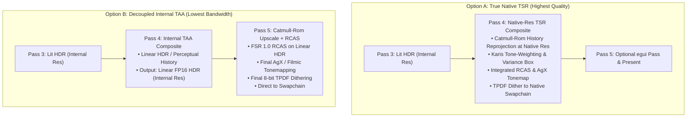
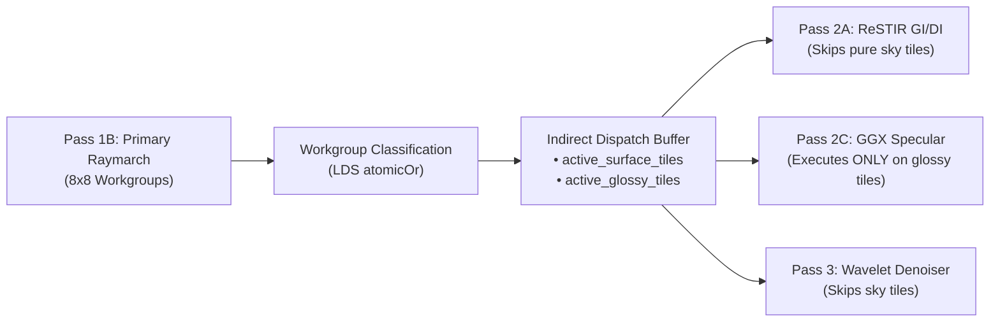

# Rendering Architecture Critique, Gaps & Optimization Plan

This document synthesizes the architectural review of Arcadia's rendering and lighting pipeline ([`02_rendering_and_lighting.md`](../architecture/02_rendering_and_lighting.md)), evaluating its soundness on paper, pinpointing areas of overengineering or redundant GPU bandwidth, identifying missing systems for arbitrary scenes and real-time voxel carving/placing, and outlining upgraded techniques for the upcoming roadmap items (**C2 Decoupled Specular**, **C3 Light Shafts**, and **F3 Indirect Tile Dispatch**).

---

## 1. Executive Summary & Review Verdict

### Does the architecture make sense on paper?
**Yes.** The combination of:
1. **Chunked Sparse 64-Tree (CS64)**: Direct compute raymarching with single-cycle `POPCNT` child address indexing, zero meshing/BVH rebuild stalls, and in-place dirty-slice GPU buffer patching ([`01_storage_and_memory.md`](../architecture/01_storage_and_memory.md)),
2. **ReSTIR GI / DI in Screen-Space**: High-frequency spatio-temporal resampling for 1st-bounce diffuse and thousands of dynamic emissive voxels,
3. **SHARC Surfel Radiance Cache in World-Space**: View-independent 4-way set-associative spatial hash for $2\dots\infty$ multi-bounce diffuse feedback without recursive path-tracing,

is conceptually sound and fits real-time editable voxel engines far better than traditional meshed triangle BVHs or Eulerian 3D volume grids.

### Verdict Matrix

| Architectural Area | Status | Key Verdict |
| :--- | :--- | :--- |
| **CS64 Voxel Traversal** | **Strong** | Excellent cache footprint and update latency. Needs $64\text{ m}$ super-chunk bitmasks for large open horizons. |
| **Multi-Bounce SHARC + ReSTIR GI** | **Strong** | Mathematically rigorous. Needs active edit-sphere history invalidation to react instantly to carving/placing. |
| **G-Buffer Memory Footprint** | **Overengineered** | $52\text{ B/px}$ is excessive. Reconstructing world position from depth and packing normals saves $\sim 50\%$ VRAM bandwidth. |
| **TSR vs Blit Color/Upscale Pipeline** | **Conflicted** | Applying 8-bit TPDF dithering before Catmull-Rom upscaling and RCAS sharpening amplifies dither noise; Halton sub-pixel data is lost if TSR runs before upscaling. |
| **Mirror Reflections in Pass 1B** | **Bottleneck** | Inline tracing in primary raymarch causes SIMD divergence. Must be moved to decoupled half-res Pass 2C. |
| **Atmospheric Volumetrics** | **Upcoming** | A $160\times 90\times 64$ 3D froxel grid introduces Z-slice quantization stair-stepping. Half-res depth-clamped interleaved raymarching is leaner and sharper. |

---

## 2. Overengineering & Bandwidth Optimization (Trimming Fat)

### 2.1 G-Buffer Compactification ($52\text{ B/px} \to 20\text{ B/px}$)

In [`02_rendering_and_lighting.md` §7.1](../architecture/02_rendering_and_lighting.md#L267-L284), `ScreenResources` allocates three 16-byte storage buffers plus depth:
- `gbuf_pos_depth_buf`: `vec4<f32>` (world position $X, Y, Z$, linear depth) = 16 B
- `gbuf_norm_mat_buf`: `vec4<f32>` (normal $X, Y, Z$, material ID) = 16 B
- `gbuf_albedo_motion_buf`: `vec4<f32>` (albedo RGB, motion UV, contact AO) = 16 B
- `gbuf_depth_tex`: `Depth32Float` = 4 B
- **Total: $52\text{ bytes per pixel}$.**

#### The Redundancy
1. **World Position (`pos.xyz`, 12 B/px) is completely redundant:**
   Given `linear_depth`, pixel screen coordinates, and camera ray basis vectors already stored in `CameraUniforms`, reconstructing world position takes **1 FMA instruction** in ALU:
   $$\mathbf{p}_{\text{world}} = \mathbf{c}_{\text{cam\_pos}} + \hat{\mathbf{d}}_{\text{ray}} \cdot d_{\text{linear}}$$
   Storing 12 bytes of position across Pass 1 (write), SHARC Update (read), Pass 2A (read), Pass 2B (spatial neighbor reads), and Pass 3 (up to 16 Vogel-disk taps) saturates GPU L2 cache and memory channels.
2. **Surface Normal (`norm.xyz`, 12 B/px) is oversized:**
   Even for arbitrary 6-DOF rotated rigid bodies, an Octahedral normal representation (`pack2x16snorm`) provides sub-degree precision in 4 bytes. For axis-aligned CS64 terrain, 3 bits (face index $0\dots 5$) would suffice, but Oct16 cleanly unifies terrain and dynamic bodies.

#### Target Compact G-Buffer Layout ($20\text{ B/px}$)

```
Slot 0: gbuf_depth_mat_buf (8 bytes / vec2<u32>)
┌───────────────────────────────────────┬───────────────────┬──────────────┐
│ u32 depth_f32 (bits of linear_depth)  │ u16 material_id   │ u16 flags    │
└───────────────────────────────────────┴───────────────────┴──────────────┘

Slot 1: gbuf_norm_motion_buf (8 bytes / vec2<u32>)
┌───────────────────────────────────────┬──────────────────────────────────┐
│ u32 octahedral_normal (pack2x16snorm) │ u32 motion_vector (pack2x16float)│
└───────────────────────────────────────┴──────────────────────────────────┘

Slot 2: gbuf_albedo_ao_buf (4 bytes / u32)
┌───────────────────────────────────────┬──────────────────────────────────┐
│ u24 albedo (R8G8B8)                   │ u8 contact_ao                    │
└───────────────────────────────────────┴──────────────────────────────────┘
```

**Benefits:**
- Cuts bandwidth for spatial gathers (Pass 2B ReSTIR and Pass 3 Wavelet Denoiser) by **$\approx 61\%$**.
- Increases cache line hit rate during non-coherent Vogel-disk filtering.

---

### 2.2 Resolution & Color Pipeline Alignment (Pass 4 & Pass 5 Conflict)

The handoff between Pass 4 (`composite_dlaa.wgsl`) and Pass 5 (`blit.wgsl`) has two pipeline discrepancies:

#### Issue A: Dithering Before Spatial Upscaling & Sharpening
- Pass 4 applies AgX tonemapping and **TPDF 8-bit quantization dithering** into `out_tex` (`Rgba8Unorm`).
- Pass 5 takes `out_tex` and runs **5-tap Catmull-Rom upsampling and AMD FSR 1.0 RCAS sharpening**.
- **Problem:** Running high-pass sharpening (RCAS) on an 8-bit dithered image amplifies the triangular dither noise pattern into visible high-frequency grain and ringing halos around edges. Furthermore, Catmull-Rom interpolates non-linear tonemapped values.

#### Issue B: TAA vs True Super-Resolution (TSR)
- Pass 1 jitters primary camera rays with Halton $(2,3)$ sub-pixel offsets.
- When `render_scale < 1.0` (e.g., $0.75\times$), the purpose of Halton jittering is to deposit sub-pixel surface information into a **native-resolution history buffer**.
- Because Pass 4 operates at internal resolution, it resolves jittered samples at low resolution, leaving Pass 5 to perform purely spatial interpolation—discarding high-frequency temporal phase data.

#### Solution Options



- **Recommendation:** Implement **Option B** first as a non-breaking shader cleanup (moving AgX tonemapping and TPDF dither into `blit.wgsl` after RCAS). Transition to **Option A** when native 4K upscaling quality is prioritized.

---

## 3. Critical Gaps for Arbitrary Scenes & Real-Time Carving/Placing

### 3.1 Active Invalidation of Radiance Caches on World Mutation

#### The Failure Case
In [`02_rendering_and_lighting.md` §4.4](../architecture/02_rendering_and_lighting.md#L199):
> *"evict stale entries older than 64 frames. Carved or destroyed voxel terrain is automatically purged from the cache without CPU overhead."*

Passive eviction only purges surfels **on the carved voxels themselves** because rays no longer hit them.
However, when a player:
1. Carves a window through an exterior wall into a dark room, or
2. Destroys a cluster of bright emissive crystals, or
3. Places a large stone pillar blocking the sun,

the **surrounding unchanged geometry** (cave floor, opposing walls) still receives camera rays every frame (`age == 0`). Its SHARC slot has accumulated an EMA sample count of $M = 16$, and Pass 2A temporally reprojects the previous frame's diffuse reservoir without re-testing visibility.
- **Visual Artifact:** Light lingers for 15–30 frames after blocking a light, and dark interiors take several seconds to brighten when a wall is opened.

#### Architectural Remedy: Active Edit-Sphere Invalidation
1. **CPU Uniform Binding:** When carving or placing voxels in [`sculpting.rs`](../../crates/arcadia-app/src/sculpting.rs), provide the edit bounding sphere in `CameraUniforms`:
   ```rust
   // GPU-SYNC: Edit invalidation sphere in CameraUniforms
   pub edit_sphere: [f32; 4], // xyz: world center, w: radius (0.0 if no edits this frame)
   ```
2. **SHARC Cache Decoupled EMA Clamp (`sharc_resolve.wgsl`):**
   If a surfel's world position falls within `edit_sphere.xyz` with radius `edit_sphere.w + 4.0` (light bleed margin):
   ```wgsl
   if (distance(surfel_pos, uniforms.edit_sphere.xyz) < uniforms.edit_sphere.w + 4.0) {
       // Reset accumulation to react within 1-2 frames
       slot.accum_count = min(slot.accum_count, 2u);
   }
   ```
3. **Temporal ReSTIR GI Ray-Sphere Rejection (`lighting_restir_gi.wgsl`):**
   In `temporal_main`, before accepting the historical sample $\mathbf{x}_s$ from `prev_reservoir`:
   - Compute ray segment distance from current hit $\mathbf{x}_v$ to sample $\mathbf{x}_s$ against `uniforms.edit_sphere`.
   - If the ray segment intersects the edit sphere, set temporal candidate weight $W = 0$ and $M = 0$.
4. **Stochastic Temporal Occlusion Probing (Dynamic Bodies):**
   For moving rigid bodies (`RigidBodyInstance`), historical visibility can become occluded without terrain edits. In Pass 2A, trace a low-step ($4\dots 8$ steps) shadow validation ray on **1 in every 4 pixels (rotating $2\times 2$ Bayer pattern)** for the temporal candidate.

---

### 3.2 Emissive Sampling Starvation in Arbitrary Large Scenes

#### The Failure Case
[`02_rendering_and_lighting.md` §4.2](../architecture/02_rendering_and_lighting.md#L171-L173) builds a single global Vose alias table over up to 16,384 emissive clusters weighted by total radiant flux.
- In large worlds with distant high-power emitters (e.g., an open lava canyon $200\text{ m}$ away), a global flux table will select the lava canyon for $>90\%$ of candidate samples—even when the camera is inside an enclosed bunker lit by a low-power red indicator LED.
- Pass 2B then casts a shadow ray, finds the distant lava occluded, and zeroes the reservoir ($W = 0$), resulting in black, unlit rooms.

#### Architectural Remedy
1. **Hierarchical 2-Tier Candidate Generation in Pass 2A:**
   - **Candidate 1 & 2 (Local Spatial Grid):** Sample from the local Level-2 Meso-node grid cell or ReGIR bucket containing the hit point.
   - **Candidate 3 (Global Distance-Weighted Alias):** Sample from the global Vose alias table only if distance attenuation $\frac{\Phi}{4\pi d^2}$ exceeds a threshold.
2. **Chunk-Incremental Alias Updates:**
   Avoid full rebuilds of the 16k CPU Vose alias table when editing voxels. Make `EmissiveRegistry` dirty-tracked per chunk so only modified chunk entries are replaced.

---

### 3.3 Super-Chunk ($64\text{ m}$) Empty Space Skipping

In wide-open horizons or high-altitude viewpoints, camera rays and sun shadow rays traverse large distances ($200\text{--}500\text{ m}$) of empty air.
- Stepping through empty $16\text{ m}$ Level-0 chunks one by one consumes $12\dots 32$ loop iterations before encountering terrain.
- **Remedy:** Introduce a **Super-Chunk Occupancy Mask**:
  - Group $4\times 4\times 4$ chunk roots ($64\text{ m}\times 64\text{ m}\times 64\text{ m}$) into a single `u64` bitmask stored in a small GPU buffer.
  - Primary and shadow rays perform an initial DDA step across the $64\text{ m}$ grid, advancing $64\text{ m}$ in a single bitwise step when moving through empty valleys or sky.

---

### 3.4 Decoupled Translucency & Refraction Architecture

Currently, `MAT_WATER_CRYSTAL` relies on inline caustics and underwater immersion fog, while `MAT_MIRROR_CHROME` traces inline reflections in Pass 1B.
- To handle arbitrary translucent voxels (water surfaces viewed from above, tinted glass, ice, glowing crystals), a single-layer opaque G-buffer is insufficient.
- **Remedy:**
  1. When Pass 1B primary rays hit a refractive/translucent surface, write its surface normal, roughness, and transmission color into a packed half-res specular/translucent attachment.
  2. Compute Snell's law refraction vector $\hat{\mathbf{d}}_{\text{refr}}$, apply Beer-Lambert absorption tint to the ray throughput, and **continue marching the primary ray** until it hits the underlying opaque bed.
  3. The opaque seabed/interior geometry is stored in the standard G-buffer and shaded by ReSTIR GI/DI normally.
  4. Pass 2C (Specular) then shades the translucent surface reflection and composites it over the refracted background.

---

## 4. Next-Up Techniques & Upgrades

### 4.1 Decoupled Half-Res Glossy Reflections & GGX VNDF (Pass 2C)

Moving specular reflections out of Pass 1B into a dedicated Pass 2C (`specular_trace.wgsl`) is critical to eliminating warp thread divergence.

#### Algorithmic Recommendations
1. **Bounded Spherical-Cap VNDF Sampling (Dupuy & Benyoub 2023):**
   Replace traditional Heitz 2018 ellipsoid VNDF sampling with bounded spherical-cap sampling. It eliminates numerical instability at grazing angles ($\mathbf{v} \cdot \mathbf{n} \approx 0$) and reduces WGSL branching.
2. **3-Tier Roughness Classification:**
   Avoid tracing expensive reflection rays on matte surfaces:
   - **$\text{Roughness} < 0.08$ (Mirror Tier):** Trace full/half-res sharp CS64 ray. Screen-Space Reflections (SSR) against `history_prev` linear depth first; fallback to CS64 DDA if SSR misses.
   - **$0.08 \le \text{Roughness} \le 0.50$ (Glossy Tier):** Trace half-res ray using **CS64 Ray-Cone LOD expansion** ($r_{\text{cone}} = t \cdot \alpha$). When the ray cone exceeds $0.25\text{ m}$, terminate DDA traversal early at Level-2 Meso nodes, fetch `lod_payload` color, and query SHARC for indirect incident radiance.
   - **$\text{Roughness} > 0.50$ (Matte Tier):** **Cast 0 scene rays.** Evaluate split-sum PBR approximation using the already-resolved ReSTIR GI diffuse irradiance reservoir and SHARC cache along the reflection normal.
   - *Impact:* $\sim 80\%$ of typical voxel surfaces (stone, dirt, grass, foliage) have $\text{roughness} > 0.55$, skipping ray dispatches for the vast majority of pixels.

---

### 4.2 Atmospheric Light Shafts: Interleaved Raymarching vs. 3D Froxels (Pass 2D)

`category_c_lighting_architecture_plan.md` outlines a $160\times 90\times 64$ 3D froxel grid for volumetric light shafts.

#### Tradeoff Analysis: 3D Froxel Grid vs. Half-Res 2D Interleaved Raymarching

| Metric / Attribute | 3D Froxel Grid ($160\times 90\times 64$) | Half-Res 2D Interleaved Raymarching |
| :--- | :--- | :--- |
| **VRAM Footprint** | $\approx 3.7\text{ MB}$ (Froxel volume + integration buffer) | $\approx 0.5\text{ MB}$ (2D half-res history ping-pong) |
| **Pass Complexity** | 2 passes (Injection compute + Integration compute) | 1 compute pass + temporal accumulation |
| **Z-Resolution Artifacts** | Logarithmic Z-slice quantization causes stair-step slicing on sharp voxel shadow silhouettes. | Ray steps continuously jittered with temporal blue noise; no fixed Z-plane banding. |
| **Occlusion Clamping** | Evaluates air froxels inside solid mountains unless masked by a separate Hi-Z pass. | Naturally clamped per pixel: $t_{\text{max}} = \min(t_{\text{max}}, d_{\text{linear}})$; zero steps inside solid geometry. |
| **Voxel Shadow Ray Cost** | $921,600$ cells / frame (even with $2\times 2$ checkerboard: $230\text{k}$ tests). | $\frac{W}{2} \times \frac{H}{2} \times 12\text{ steps} \approx 3.1\text{M}$ lightweight steps, fully bounded to visible air. |

#### Recommended Implementation: Half-Res Interleaved Raymarching
- Dispatch at half resolution ($\frac{W}{2} \times \frac{H}{2}$).
- Jitter ray start position using an interleaved $4\times 4$ blue-noise Bayer matrix.
- Step $12\dots 16$ samples along the view ray from $z_{\text{near}}$ to $\min(z_{\text{horizon}}, d_{\text{linear}})$.
- At each step, test sun shadow visibility using coarse CS64 Level-1/Level-2 DDA (`min_shift = 2`, maximum 6 steps).
- Apply Henyey-Greenstein phase function for forward atmospheric scattering ($g \approx 0.65$).
- Filter with a bilateral $3\times 3$ edge-stopping spatial blur and temporally accumulate into a half-res history buffer before compositing in Pass 4.

---

### 4.3 Forwarding Tile Classification & Indirect Dispatch (F3)

Rather than postponing **F3 (Indirect Tile Dispatch)** to the end of the roadmap, integrate it directly with Pass 2C (Specular):



#### Mechanism
1. In `primary_gbuffer.wgsl`, declare a workgroup shared mask:
   ```wgsl
   var<workgroup> tile_has_surface: u32;
   var<workgroup> tile_has_glossy: u32;
   ```
2. Each thread tests its hit:
   - If not sky, `atomicOr(&tile_has_surface, 1u)`.
   - If `roughness < 0.50`, `atomicOr(&tile_has_glossy, 1u)`.
3. Thread 0 appends the tile index to `active_surface_tile_list` and (if glossy) `active_glossy_tile_list` using `atomicAdd` on an indirect command buffer.
4. Subsequent passes execute via `wgpu::ComputePass::dispatch_workgroups_indirect`:
   - Saves $30\dots 50\%$ of compute in scenes with open skies.
   - Makes Pass 2C (Glossy Specular) virtually free in matte scenes.

---

## 5. Implementation Roadmap & Priority Matrix

```
Phase 1: G-Buffer & Color Pipeline Cleanup (Quick Bandwidth & Quality Wins)
├── 1.1 Reconstruct world pos from depth; pack normals to Oct16 (save 32 B/px)
├── 1.2 Move AgX tonemapping & TPDF dithering to Pass 5 (after Catmull-Rom & RCAS)
└── 1.3 Add 64m super-chunk occupancy bitmask for fast horizon ray traversal

Phase 2: World Sculpting Responsiveness
├── 2.1 Bind edit_sphere to CameraUniforms during carving/placing
├── 2.2 Clamp SHARC accum_count <= 2 in edit radius (instant multi-bounce reaction)
└── 2.3 Ray-sphere intersection check in Pass 2A temporal ReSTIR (instant shadow cut)

Phase 3: High-End Optics (C2 & C3)
├── 3.1 Extract Pass 2C Decoupled Specular (Half-res, Spherical-Cap VNDF, Ray-Cone LOD)
├── 3.2 Tile classification (F3) in Pass 1B to feed indirect dispatches
└── 3.3 Pass 2D Half-Res Interleaved Atmospheric Light Shafts
```

### Action Item Reference Checklist

- [x] **G-Buffer**: Shrink `ScreenResources` from $52\text{ B/px}$ to $20\text{ B/px}$ in [`gbuffer.rs`](../../crates/arcadia-render/src/gbuffer.rs) (Completed: 20 B/px compact layout with ALU world position reconstruction).
- [x] **Post-Processing**: Move tonemapping and TPDF dithering from `composite_dlaa.wgsl` into `blit.wgsl`.
- [ ] **Sculpting Sync**: Implement `edit_sphere` uniform in `CameraUniforms` and clamp SHARC EMA count on edits.
- [ ] **ReSTIR DI**: Add local ReGIR / spatial grid sampling prior to global Vose alias table selection in `lighting_restir_gi.wgsl`.
- [ ] **Pass 2C Specular**: Create `shaders/specular_trace.wgsl` and remove mirror reflections from `primary_gbuffer.wgsl`.
- [ ] **Pass 2D Volumetrics**: Implement half-res depth-clamped light shaft raymarching with temporal reprojection.
- [ ] **Tile Dispatch**: Implement `tile_classify` compute pass and dispatch passes indirectly.

