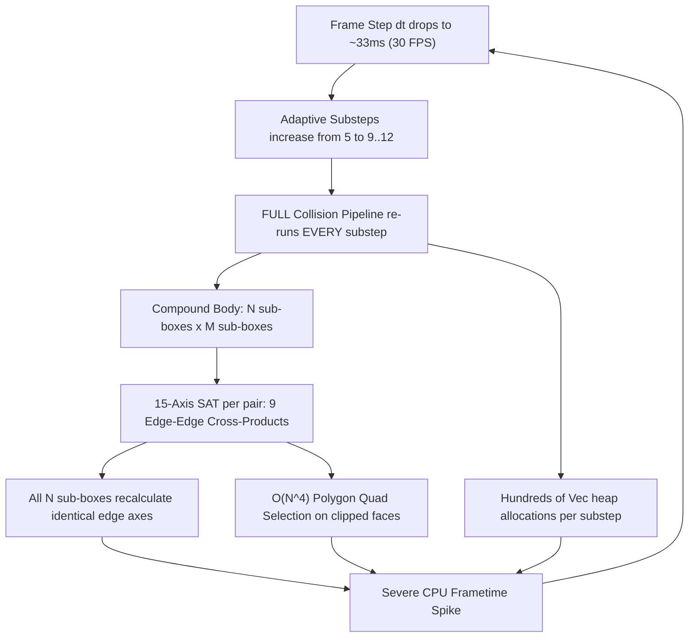
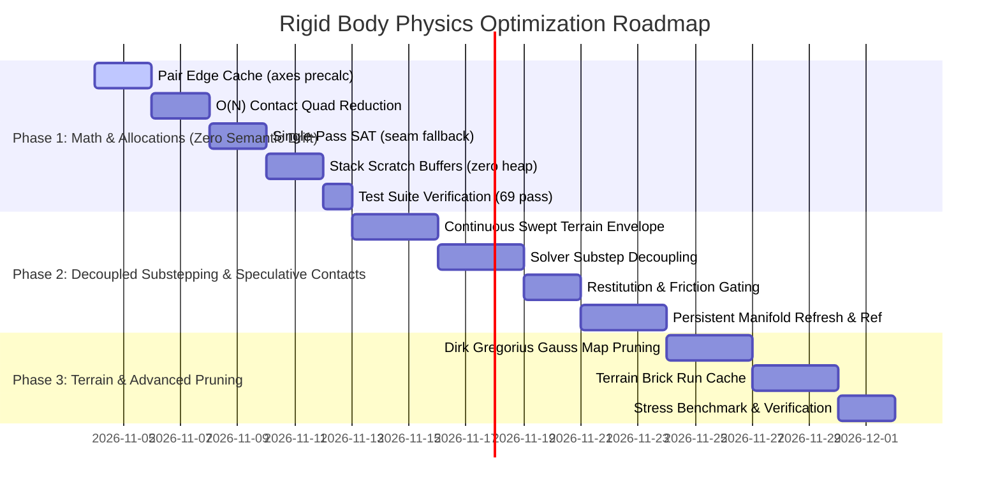

# 6-DOF Rigid Voxel Physics: Real-Time Performance & Speculative Contacts Architecture Plan

This document establishes the technical diagnosis, mathematical formulation, and production implementation plan to achieve deterministic, real-time 60+ FPS physics simulation for arbitrary 6-DOF voxel rigid bodies in Arcadia. 

It addresses the core bottlenecks documented in [ARCHITECTURE.md](../../ARCHITECTURE.md) and identified in [`crates/arcadia-physics/src/rigid_voxel/`](../../crates/arcadia-physics/src/rigid_voxel/), with special emphasis on **pair-level edge cross-product caching**, **decoupled substep collision lifecycles**, **speculative contacts / continuous contact envelopes**, **swept terrain broadphase envelopes**, and **zero-allocation scratch memory**.

---

## 1. Executive Summary & Problem Diagnosis

Arcadia currently features a high-fidelity 6-DOF rigid voxel dynamics engine based on greedy-cuboid compound colliders (`CompoundCollider`), 15-axis Separating Axis Theorem (SAT) narrowphase with exposed-face bitmasks, Sutherland-Hodgman contact polygon clipping, and a split-impulse sequential solver with bottom-up shock propagation.

While the simulation delivers realistic stacking and concave interlocking (arches, bowls, fallen pillars) without clipping or air padding, complex carved objects or piles of rubble occasionally trigger severe frametime spikes.

### The 5 Compounding Bottlenecks



| Bottleneck | Location in Codebase | Mechanism | Real-World Impact |
| :--- | :--- | :--- | :--- |
| **1. Substep Collision Re-run Loop** | [`solver/mod.rs:208–282`](../../crates/arcadia-physics/src/rigid_voxel/solver/mod.rs#L208-L282) | Full terrain queries, tandem BVH traversal, and 15-axis SAT are re-run on **every single substep** (4 to 12 times per frame). | **5× to 12× multiplier** on all collision costs; creates a framerate death spiral when frames drop. |
| **2. Redundant Edge-Edge SAT Checks** | [`manifold.rs:231–260`](../../crates/arcadia-physics/src/rigid_voxel/collision/manifold.rs#L231-L260) | All sub-boxes of Body A share the exact same 3 edge directions ($R_A$), and all sub-boxes of Body B share $R_B$. Yet every sub-box pair normalizes and projects the same 9 cross products over and over. | Redundant square roots, vector normalizations, and extent projections scaling with $O(N_A \times N_B)$. |
| **3. $O(N^4)$ Quad Area Maximization** | [`manifold.rs:845–875`](../../crates/arcadia-physics/src/rigid_voxel/collision/manifold.rs#L845-L875) | Clipped polygon vertices ($N > 4$) are evaluated across all combinations $\binom{N}{4}$ using 4 nested loops to find the max-area quad. | For $N = 8$: 70 shoelace quad evaluations per clipped face; for $N = 12$: 495 evaluations per clipped face. |
| **4. Double-SAT Seam Fallback** | [`manifold.rs:108–138`](../../crates/arcadia-physics/src/rigid_voxel/collision/manifold.rs#L108-L138) | If exposed-face SAT returns `None` due to internal seam masking, the engine executes the entire 15-axis SAT **a second time** with `ALL_FACES_EXPOSED`. | Doubles narrowphase SAT compute on deeply touching or interpenetrating compound bodies. |
| **5. Inner-Loop Heap Allocation Churn** | Multiple files in `rigid_voxel/` | Dynamic `Vec` allocations (`stack`, `pairs`, `poly`, `clusters`, `terrain_data`, `manifolds`) inside the substep loop. | Heavy allocator lock contention, L1/L2 cache evictions, and micro-stutter. |

---

## 2. Core Upgraded Architecture: The 5 Pillars

### Pillar 1: Decoupled Collision Lifecycle & Persistent Contact Manifolds
In industry-standard physics engines (NVIDIA PhysX PCM, Bullet `btPersistentManifold`, Box2D), **collision detection runs ONCE per frame** (or at a fixed broadphase rate), while the **substep loop solves impulses and updates velocities/positions**.

```
Frame Start
   │
   ▼
[ 1. Broadphase & Compound BVH Narrowphase ] ──── (Runs ONCE per frame)
   │  • Discovers all active & speculative contacts (Bodies & Swept Terrain)
   │  • Identifies reference body and stores contact normal in reference local space
   │  • Stores contact positions in body-local coordinates (r_local_a, r_local_b)
   │
   ▼
[ 2. Substep Solver Loop (4..12 Substeps) ]
   │
   ├── For each substep (sub_dt = dt / num_substeps):
   │     ├─ A. Refresh Contact Geometries (O(1) local-to-world update + normal rotation)
   │     ├─ B. Speculative Clamping (Inelastic arrival for s > slop; 0 friction)
   │     ├─ C. Velocity Gauss-Seidel Solver (Impulses + Coulomb friction; 100% intra-frame retention)
   │     ├─ D. Integrate Transforms (x += v * dt, q = q * dq)
   │     └─ E. Split-Impulse Position Projection (Physical contacts only; s <= slop)
   │
   ▼
Frame End (Warm-start decay 0.85; Upload to GPU Instance Buffer)
```

1. **Persistent Local Storage:** Each contact point caches its anchor positions relative to Body A and Body B local space:
   $$\mathbf{r}_{A,\text{local}} = R_A^T (\mathbf{p}_{\text{world}} - \mathbf{x}_A), \quad \mathbf{r}_{B,\text{local}} = R_B^T (\mathbf{p}_{\text{world}} - \mathbf{x}_B)$$

2. **Reference Frame Tracking for Contact Normal:** The contact normal $\mathbf{n}$ must stay locked to the reference feature (Body A face or Body B face) across substep rotations:
   $$\mathbf{n}_{\text{local}} = R_{\text{ref}}^T \mathbf{n}_{\text{world}}$$
   On each substep $t$, the world contact normal is refreshed via reference orientation:
   $$\mathbf{n}(t) = \begin{cases} R_A(t) \mathbf{n}_{\text{local}} & \text{if reference is Body A} \\ -R_B(t) \mathbf{n}_{\text{local}} & \text{if reference is Body B} \end{cases}$$
   *(Ensures $\mathbf{n}(t)$ consistently points from Body A toward Body B without drifting under angular rotation).*

3. **Substep Geometric Refresh ($O(1)$ per point):** As bodies move during substeps, their separation distance is updated without re-running BVH or SAT:
   $$s(t) = \left[(\mathbf{x}_B(t) + R_B(t) \mathbf{r}_{B,\text{local}}) - (\mathbf{x}_A(t) + R_A(t) \mathbf{r}_{A,\text{local}})\right] \cdot \mathbf{n}(t)$$

4. **Lifecycle Culling:** A cached contact is retained across substeps unless:
   - Separation exceeds the breaking threshold ($s > 0.04\text{ m}$).
   - Tangential drift exceeds the feature match radius ($\|\Delta \mathbf{r}_{\text{tangent}}\| > 0.035\text{ m}$).
   - The contact normal flips ($\mathbf{n}(t) \cdot \mathbf{n}_{\text{initial}} < 0.70$).

5. **Intra-Frame vs. Inter-Frame Warm Starting:**
   - **Between substeps (intra-frame):** Maintain **100%** of accumulated normal and tangent impulses across consecutive substeps $(k \to k+1)$ within the frame. This guarantees true Gauss-Seidel mathematical convergence.
   - **Across frames (inter-frame):** Apply `WARM_START_FACTOR = 0.85` damping **only** across frame boundaries $(T \to T+1)$ when matching newly generated contacts against persistent manifolds from the previous frame.

---

### Pillar 2: Speculative Contacts & Continuous Contact Envelopes

To decouple collision detection from substeps without introducing tunneling or missed collisions on fast-moving bodies, Arcadia integrates **Speculative Contacts** (velocity-expanded collision envelopes).

#### 2.1 The Speculative Constraint Equation
In standard discrete collision detection, constraints only push bodies apart when they are already penetrating ($s \le 0$).

With speculative contacts, the collision detection envelope is expanded along the relative velocity vector:
$$\text{Envelope} = \|\mathbf{v}_{\text{rel}}\| \Delta t_{\text{frame}} + \text{SKIN}$$

When a potential contact is discovered with a positive gap ($s > 0$):
1. A contact constraint is created with separation distance $s$.
2. The velocity solver constraint target is formulated as:
   $$\mathbf{v}_{\text{rel}} \cdot \mathbf{n} \ge -\frac{s}{\Delta t_{\text{sub}}}$$
   *(where $s$ is the remaining gap and $\Delta t_{\text{sub}}$ is the current substep delta).*

```
Frame Start:
[ Body A ] ─── (v = 12 m/s) ───> [ Gap: s = 6 cm ] ───> [ Voxel Wall ]

Solver Clamp:
Max allowed approach velocity = s / sub_dt = 0.06m / 0.004s = 15.0 m/s
(Body arrives flush at the wall with zero penetration)
```

#### 2.2 Swept Terrain Voxel Envelope
Unlike dynamic body pairs with persistent rigid frames, **voxel terrain contacts are defined by discrete static brick boundaries ($0.25\text{ m}$ intervals)**. A fast-moving body ($v \ge 15\text{ m/s}$) travels $\sim 0.25\text{ m}$ per frame and can cross multiple voxel cells within a single frame.

**The Swept Terrain Broadphase Rule:**
- The terrain AABB query must encompass the entire frame displacement trajectory:
  $$\text{AABB}_{\text{terrain\_query}} = \text{AABB}_{\text{start}} \cup \text{AABB}_{\text{end}} + \text{SKIN}$$
  where $\text{AABB}_{\text{end}}$ is evaluated at $\mathbf{x} + \mathbf{v} \Delta t_{\text{frame}} + \frac{1}{2} \mathbf{g} \Delta t_{\text{frame}}^2$.
- All candidate terrain brick runs across the full swept frame envelope are extracted during the frame-start collision pass.
- For resting / settled bodies ($\|\mathbf{v}\| < 0.05\text{ m/s}$), terrain brick runs are cached across frames with zero re-querying.

#### 2.3 Bouncy Objects: Inelastic Arrival, Elastic Rebound
A classic pitfall of speculative contacts is the **"invisible force field" bug**, where applying restitution $e > 0$ while $s > 0$ causes an object to bounce off thin air before reaching the wall.

Arcadia's substepping architecture naturally resolves this through **Restitution Distance Gating**:

```mermaid
sequenceDiagram
    autonumber
    participant Body as Dynamic Voxel Body
    participant Solver as Substep Solver
    participant Wall as Static Terrain / Wall
    
    Note over Body,Wall: Substep 1: Gap s = 4.0 cm (> PENETRATION_SLOP)
    Note over Solver: Contact is SPECULATIVE -> e = 0.0, Friction = 0.0
    Solver->>Body: Clamp approach velocity to s / sub_dt
    Body->>Wall: Body moves flush to surface; gap closes to s <= 2 mm
    
    Note over Body,Wall: Substep 2: Gap s <= PENETRATION_SLOP (2 mm)
    Note over Solver: Contact is now PHYSICAL -> Restitution e > 0 engages!
    Solver->>Body: Normal impulse: v_out = -e * v_in
    Body->>Body: Body accelerates outward
    
    Note over Body,Wall: Substep 3+: Separation
    Body->>Body: Body rebounds cleanly off surface
```

**Guardrail Rules for Bouncy Objects:**
1. **Restitution Gated on Gap:**
   $$\mu_{\text{restitution}} = \begin{cases} \text{body.restitution} & \text{if } s \le \text{PENETRATION\_SLOP} \ (2\text{ mm}) \\ 0.0 & \text{if } s > \text{PENETRATION\_SLOP} \end{cases}$$
2. **Ghost-Braking Immunity:** Coulomb friction is **strictly zero** while $s > \text{PENETRATION\_SLOP}$. Speculative contacts never exert tangential friction against empty air.
3. **Corner Snagging Immunity:** Speculative contacts are only generated if closing velocity opposes the surface normal ($\mathbf{v}_{\text{rel}} \cdot \mathbf{n} < -0.05\text{ m/s}$). Moving parallel to a 90-degree voxel ledge never triggers horizontal stopping impulses.

---

### Pillar 3: Pair-Level SAT Edge Optimization & Gauss Map Pruning

#### 3.1 Global Edge Cross-Product Caching
In [`collision/manifold.rs`](../../crates/arcadia-physics/src/rigid_voxel/collision/manifold.rs), testing edge-edge axes currently performs vector cross products and normalizations for every sub-box pair.

Because all sub-boxes in Body A share orientation matrix $R_A = [\mathbf{u}_{A,0}, \mathbf{u}_{A,1}, \mathbf{u}_{A,2}]$, and all sub-boxes in Body B share $R_B = [\mathbf{u}_{B,0}, \mathbf{u}_{B,1}, \mathbf{u}_{B,2}]$, the 9 edge cross-product directions are **identical across all sub-box pairs between the two bodies**:

$$\mathbf{e}_{ij} = \mathbf{u}_{A,i} \times \mathbf{u}_{B,j} \quad (i, j \in \{0, 1, 2\})$$

**Optimization:**
- Precompute and normalize the 9 edge directions **once per body pair** in `compute_compound_pair_manifolds_indexed`:
  ```rust
  pub struct PairEdgeCache {
      pub axes: [Vec3; 9],
      pub valid: [bool; 9],
  }
  ```
- Sub-box pairs skip vector cross products and square roots entirely, directly performing dot-product interval projections onto the cached unit axes.

#### 3.2 Dirk Gregorius Gauss Map (Minkowski Face) Pruning
Following Dirk Gregorius (Valve GDC 2013, *"The Separating Axis Test between Convex Polyhedra"*), an edge pair $(\mathbf{e}_A, \mathbf{e}_B)$ can only form a contact normal if their spherical normal arcs intersect on the unit sphere (Gauss map).

For orthogonal box edges:
- Let the edge of Box A have outward face normals $\mathbf{n}_{A,1}, \mathbf{n}_{A,2}$.
- Let the edge of Box B have outward face normals $\mathbf{n}_{B,1}, \mathbf{n}_{B,2}$.
- Let $\mathbf{e}_{AB} = \mathbf{e}_A \times \mathbf{e}_B$. If $\|\mathbf{e}_{AB}\|^2 < 10^{-6}$ (edges parallel), skip edge check (already handled by face axes).
- The edge pair forms a valid Minkowski face if and only if the scalar projections satisfy:
  $$(\mathbf{n}_{A,1} \cdot \mathbf{e}_{AB}) \cdot (\mathbf{n}_{A,2} \cdot \mathbf{e}_{AB}) \le 0$$
  and
  $$(\mathbf{n}_{B,1} \cdot \mathbf{e}_{AB}) \cdot (\mathbf{n}_{B,2} \cdot \mathbf{e}_{AB}) \le 0$$
- Performing this scalar multiplication check in $O(1)$ discards **70% to 90% of edge-edge checks** before computing any projection intervals or penetration distances.

#### 3.3 Single-Pass SAT (Eliminating Double-SAT Seam Fallback)
Currently, if `compute_subbox_obb_manifold` rejects an axis because it borders an internal unexposed seam, the engine runs the full 15-axis SAT a second time with `ALL_FACES_EXPOSED` (lines 108–138).

**Optimization:** Replace this with a **single-pass dual accumulator**:
- Track `min_exposed_overlap` (only considering exposed faces/edges).
- Simultaneously track `min_any_overlap` (considering all axes).
- If `min_exposed_overlap` yields no valid axis but `min_any_overlap` indicates deep penetration, fall back directly to `min_any_overlap` without re-running the 15 SAT projections.

---

### Pillar 4: $O(N)$ Greedy Extremal Contact Quad Selection

When Sutherland-Hodgman polygon clipping yields $N > 4$ vertices (typically 6 to 8 vertices when rectangular cuboids intersect), [`select_best_quad_points`](../../crates/arcadia-physics/src/rigid_voxel/collision/manifold.rs#L845-L875) runs 4 nested loops $\binom{N}{4}$, calculating shoelace formulas up to 495 times per face.

**Replacement: Erin Catto / Box2D $O(N)$ Extremal Heuristic:**

```rust
/// Selects up to 4 points that maximize support polygon area in O(N) time.
pub fn select_best_quad_points_fast(pts: &[(Vec3, f32)], u_axis: Vec3, v_axis: Vec3) -> [(Vec3, f32); 4] {
    // 1. Point 1: Deepest penetration point (maximum stability anchor).
    let (i0, _) = pts.iter().enumerate().max_by(|a, b| a.1.1.total_cmp(&b.1.1)).unwrap();
    let p0 = pts[i0];
    let u0 = p0.0.dot(u_axis);
    let v0 = p0.0.dot(v_axis);

    // 2. Point 2: Furthest 2D distance from Point 1.
    let (i1, _) = pts.iter().enumerate().max_by(|a, b| {
        let da = (a.1.0.dot(u_axis) - u0).hypot(a.1.0.dot(v_axis) - v0);
        let db = (b.1.0.dot(u_axis) - u0).hypot(b.1.0.dot(v_axis) - v0);
        da.total_cmp(&db)
    }).unwrap();
    let p1 = pts[i1];

    // 3. Point 3: Point maximizing triangle area with (p0, p1) (largest cross product).
    let edge = Vec2::new(p1.0.dot(u_axis) - u0, p1.0.dot(v_axis) - v0);
    let (i2, _) = pts.iter().enumerate().max_by(|a, b| {
        let cross_a = (Vec2::new(a.1.0.dot(u_axis) - u0, a.1.0.dot(v_axis) - v0).perp_dot(edge)).abs();
        let cross_b = (Vec2::new(b.1.0.dot(u_axis) - u0, b.1.0.dot(v_axis) - v0).perp_dot(edge)).abs();
        cross_a.total_cmp(&cross_b)
    }).unwrap();
    let p2 = pts[i2];

    // 4. Point 4: Point on opposite side of edge (p0, p1) maximizing quad area.
    // Falls back to next largest extremal point if all points are colinear/coplanar.
    ...
}
```
**Impact:** Drops quad selection from $O(N^4)$ down to **$4 \times N$ operations**, executing in $< 0.0005\text{ ms}$ with zero heap allocation.

---

### Pillar 5: Zero-Allocation Scratch Arena

Dynamic `Vec` allocations during simulation stepping create memory fragmentation and CPU cache misses.

**Contract:** No heap allocation is permitted in the simulation stepping hot path.

1. **Fixed-Size Clip Polygons:** Sutherland-Hodgman clipping between two cuboids can never produce more than 8 vertices. All polygon buffers in `clip_polygon_against_plane` use fixed stack arrays:
   ```rust
   pub struct FixedPolygon8 {
       pub verts: [Vec3; 8],
       pub count: usize,
   }
   ```
2. **Tandem BVH Stack:** The recursive BVH traversal in `gather_overlapping_subbox_pairs` uses a fixed stack:
   ```rust
   let mut stack = [(0u32, 0u32); 64];
   let mut sp = 1usize;
   ```
3. **Reusable Solver Buffers:** In `RigidVoxelBody::step_system`, scratch buffers for `manifolds`, `terrain_data`, and `support_levels` are retained across frames within a dedicated `PhysicsScratchArena` owned by `WorldMap` or `App`.

---

## 3. Mathematical Contracts & Data Structures

### 3.1 Reference Body & Feature Association
```rust
/// Identifies which body owns the reference feature for normal calculation.
#[derive(Clone, Copy, Debug, PartialEq, Eq)]
pub enum ReferenceBody {
    BodyA,
    BodyB,
}
```

### 3.2 Contact Point Representation
```rust
/// Exact 3D contact point supporting both physical penetration and speculative separation.
#[derive(Clone, Copy, Debug, Default)]
pub struct ContactPoint3D {
    /// World-space position of contact (or mid-point of speculative gap).
    pub position: Vec3,
    /// Offset from Body A CoM in Body A local space (cached for O(1) substep refresh).
    pub local_r_a: Vec3,
    /// Offset from Body B CoM in Body B local space (cached for O(1) substep refresh).
    pub local_r_b: Vec3,
    /// Contact normal expressed in reference body's local space (preserves orientation under rotation).
    pub local_normal: Vec3,
    /// Designates which body's orientation drives `local_normal`.
    pub ref_body: ReferenceBody,
    /// Signed separation distance: negative = penetration (m), positive = speculative gap (m).
    pub separation: f32,
    /// Accumulated normal impulse (N*s) for warm-starting.
    pub accum_n: f32,
    /// Accumulated tangent impulses (N*s) along orthonormal basis.
    pub accum_t1: f32,
    pub accum_t2: f32,
    /// Effective constraint mass along normal axis.
    pub effective_mass_n: f32,
    pub effective_mass_t1: f32,
    pub effective_mass_t2: f32,
    /// Persistent tracking identifier matching contacts across frames.
    pub feature_id: u32,
}
```

### 3.3 Pair Manifold Representation
```rust
/// Manifold grouping up to 4 coplanar contact points between two bodies.
#[derive(Clone, Copy, Debug)]
pub struct BodyPairManifold {
    pub body_a_idx: usize,
    pub body_b_idx: usize,
    /// Unit contact normal pointing from Body A toward Body B in world space.
    pub normal: Vec3,
    pub tangent1: Vec3,
    pub tangent2: Vec3,
    pub ref_body: ReferenceBody,
    /// Up to 4 contact points forming the support polygon.
    pub points: [ContactPoint3D; 4],
    pub point_count: usize,
    pub friction: f32,
    pub restitution: f32,
    /// True if all contact points represent an anticipatory gap (separation > 0).
    pub is_speculative: bool,
}
```

---

## 4. Phased Implementation Roadmap



### Phase 1: Immediate Arithmetic & Memory Quick-Wins (Target: 3× Speedup)
> [!NOTE]
> Phase 1 changes zero solver semantics or substep scheduling. All 69 existing tests must pass identically before proceeding to Phase 2.

- [ ] **1.1 Pair Edge Cross-Product Caching:** In [`manifold.rs`](../../crates/arcadia-physics/src/rigid_voxel/collision/manifold.rs), precalculate the 9 normalized cross-product vectors once per body pair. Pass pre-normalized axes to all sub-box tests.
- [ ] **1.2 $O(N)$ Quad Selection:** Replace $\binom{N}{4}$ brute-force loops in `select_best_quad_points` with the 4-point extremal heuristic.
- [ ] **1.3 Single-Pass SAT:** Merge exposed-face SAT and full-face SAT into a single traversal in `compute_subbox_obb_manifold`.
- [ ] **1.4 Fixed-Size Stack Buffers:** Convert polygon clipping (`FixedPolygon8`) and tandem BVH traversal (`stack: [(u32, u32); 64]`) to fixed-capacity stack storage.
- [ ] **1.5 Validation Checkpoint:** Verify complete regression-free pass with `cargo nextest run -p arcadia-physics` (all 69 tests green).

### Phase 2: Decoupled Substepping & Speculative Contacts (Target: 4× Additional Speedup)
- [ ] **2.1 Swept Bounding Volumes (Bodies & Terrain):** In [`broadphase.rs`](../../crates/arcadia-physics/src/rigid_voxel/collision/broadphase.rs) and [`terrain.rs`](../../crates/arcadia-physics/src/rigid_voxel/collision/terrain.rs), expand body AABBs and terrain query windows by $\text{AABB}_{\text{start}} \cup \text{AABB}_{\text{end}} + \text{SKIN}$.
- [ ] **2.2 Decouple Collision Detection from Substeps:** In [`solver/mod.rs`](../../crates/arcadia-physics/src/rigid_voxel/solver/mod.rs), move `generate_world_contacts_detailed` and `compute_compound_pair_manifolds_indexed` outside the `for _ in 0..num_substeps` loop.
- [ ] **2.3 Speculative Velocity Solver:** Enforce $v_{\text{rel}} \cdot \mathbf{n} \ge -s / \Delta t_{\text{sub}}$ for contacts with $s > 0$. Zero out friction and position correction on speculative contacts.
- [ ] **2.4 Restitution Distance Gating:** Gate restitution strictly on physical contact ($s \le \text{PENETRATION\_SLOP}$).
- [ ] **2.5 Substep Contact Position & Normal Refresh:** Update $s(t)$ and $\mathbf{n}(t)$ geometrically using cached local anchors $(\mathbf{r}_{A,\text{local}}, \mathbf{r}_{B,\text{local}})$ and reference body rotation $R_{\text{ref}}(t) \mathbf{n}_{\text{local}}$ on each substep. Maintain 100% warm-start impulses between substeps.

### Phase 3: Terrain Caching & Gauss Map Pruning (Target: 2× Additional Speedup)
- [ ] **3.1 Gauss Map Pruning:** Implement scalar Minkowski face check: $(\mathbf{n}_{A,1} \cdot \mathbf{e}_{AB}) \cdot (\mathbf{n}_{A,2} \cdot \mathbf{e}_{AB}) \le 0$ to reject non-support box edge pairs in $O(1)$.
- [ ] **3.2 Terrain Static Brick Run Cache:** Cache exposed solid cuboids per static $4^3$ Leaf Brick in [`arcadia-world`](../../crates/arcadia-world/), eliminating redundant intra-brick bit-scanning on resting terrain contacts.
- [ ] **3.3 Stress Verification Suite:** Run the 69 existing physics tests (`cargo nextest run -p arcadia-physics`) and benchmark high-velocity kinetic impacts (> 20 m/s) to verify zero tunneling and zero clipping.

---

## 5. Verification & Acceptance Criteria

1. **Substep Scaling:** Frame physics time must remain strictly flat ($\le 1.8\text{ ms}$ for 32 active bodies on CPU) regardless of whether the simulation runs at 60 FPS (5 substeps) or 30 FPS (9 substeps).
2. **Zero Tunneling:** Fast-moving dynamic objects ($v \ge 25\text{ m/s}$) impacting 1-voxel thin walls must never tunnel or pass through.
3. **Zero Invisible Bounces:** Bouncy bodies ($e \ge 0.5$) impacting static obstacles must rebound directly from the surface, with zero mid-air premature rebounds.
4. **Zero Heap Allocation:** Profiling `step_system` in a steady-state scene must record **0 heap allocations per frame**.
5. **Stacking Stability:** Piles of 10+ interlocked or rotated voxel bodies must come to rest without jitter, vibration, or sleep-wake thrashing.
