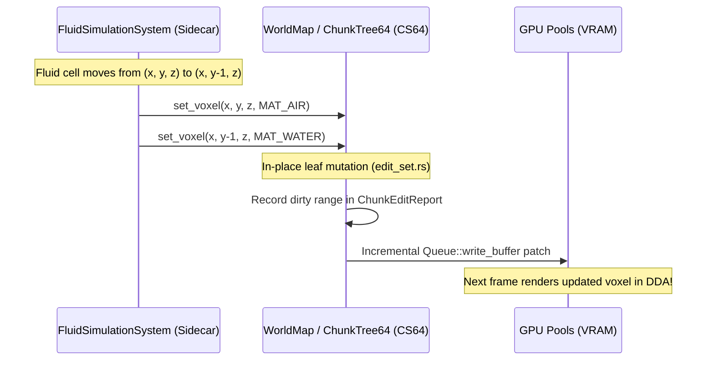

# Voxel Data, Dynamic Attributes & Sidecar Architecture Plan
## Synthesis of John Lin's "The Perfect Voxel Engine" & Roadmap for Arcadia

---

## 1. Executive Summary & Problem Diagnosis

### Background & Context
In his influential blog post *"The Perfect Voxel Engine"*, John Lin identified the defining failure mode of voxel engines over the past decade: **developers build an engine around a single, rigid rendering format** (such as SVOs, SVDAGs, or monolithic uniform grids), only to find that physics, collision, lighting, simulation, dynamic attributes, and destruction cannot scale or adapt without painful, full-codebase rewrites.

Lin's thesis is:
1. **Voxel engines exist for games, not just rendering:** Physics, destruction, dynamic objects, fluids, fire, and AI must be first-class citizens.
2. **"It's all about the data":** A single rigid voxel struct (`dumb_voxel_grid_t`) with hardcoded fields (albedo, normals, health, redstone, vegetation) wastes memory on inert matter and cannot scale.
3. **Modular by design:** Use whatever format is best for each job, unified by three core primitives: **Allocation**, **Tagging**, and **Conversion**.

### Current State of Arcadia
Arcadia already excels where most voxel engines fail:
- **Game-First Architecture:** 6-DOF dynamic rigid bodies with compound greedy colliders, 15-axis SAT, *Teardown*-style structural island collapse via perimeter-seeded flood fills, and bitwise kinematic character collision—all with **zero triangle mesh generation**.
- **High-Performance Core:** 4-level Chunked Sparse 64-Tree (CS64) with single-cycle `POPCNT` indexing, in-place zero-repack leaf mutation, and sub-8ms compute shader DDA raymarching with ReSTIR GI and SHARC radiance caching.

### The Looming Architectural Bottleneck
Despite these strengths, Arcadia currently relies on a **monolithic 8-bit `MaterialId` (`u8`)**:
- Every non-uniform leaf voxel in [`LeafBrick64`](../crates/arcadia-core/src/node64.rs#L113-L121) is rigidly packed as 1 byte (`[u32; 16]`, 64 bytes total).
- The global material palette is capped at **256 materials**.
- There is **no mechanism to store per-voxel simulation state** (water mass/velocity, fire temperature, vegetation growth, electrical logic, or custom paint colors).

If we naively expand `LeafBrick64` to store these attributes, **VRAM and GPU bandwidth will explode by 400% to 800%**, destroying the engine's sub-8ms frame budget. If we try to squeeze dynamic states into the 256-entry palette, we run out of material IDs immediately.

This document establishes the official architectural solution: **The 3-Class Voxel Model**, **Chunk-Local Indirection Palettes**, **Per-Brick Bitcrushed Colors**, and **Sparse Simulation Sidecar Layers**.

---

## 2. The 3-Class Voxel Data Model

To achieve infinite gameplay depth without bloating voxel storage, voxel data is formally partitioned into three distinct classes:

```mermaid
flowchart TD
    subgraph ClassA ["Class A: Spatial & Visual Geometry"]
        CS64["CS64 Tree (Node64 + LeafBrick64)"]
        A_Data["• 1-byte local MaterialId or 2/4-bit color index\n• 64-bit Occupancy Mask\n• LOD RGB8 Payload\n• Shared directly with GPU DDA"]
        CS64 --- A_Data
    end

    subgraph ClassB ["Class B: Static Physical Properties"]
        MatReg["MaterialRegistry (CPU Companion)"]
        B_Data["• Density (kg/m³) for buoyancy & mass\n• Blast hardness & fracture toughness\n• Flashpoint ignition temperature\n• Acoustic audio impedance\n• Friction & restitution"]
        MatReg --- B_Data
        B_Note["O(1) Palette Lookup Table (0 bytes on voxels)"]
    end

    subgraph ClassC ["Class C: Dynamic Simulation State"]
        Sidecars["Sparse Simulation Sidecars (Active Only)"]
        C_Data["• Fluid CA: mass (u8), velocity/flow (u8)\n• Thermal: temperature (u16), fuel (u8)\n• Logic: redstone/circuit signal (u8)\n• Flora: moisture (u8), growth ticks (u16)"]
        Sidecars --- C_Data
        C_Note["Allocated ONLY where active simulation occurs"]
    end

    ClassC -->|Phase Transition (e.g. Fire burns wood to air)| CS64
    ClassA -->|MaterialId Query| ClassB
```

### Class A: Spatial & Visual Geometry (The CS64 Core)
- **Responsibility:** Visibility, DDA raymarching, bitwise AABB collision, and LOD pre-filtering.
- **Rule:** Keep `LeafBrick64` strictly at **64 bytes**. It remains the lean, spatial backbone of the engine.

### Class B: Static Physical Properties (CPU `MaterialRegistry`)
- **Responsibility:** Intrinsic material behaviors that do not vary dynamically across individual voxels of the same type.
- **Rule:** Store in an extended CPU-side `MaterialProperties` table indexed by `MaterialId`. Voxels store **0 extra bytes**. Physics, destruction, and audio query this table in $O(1)$ time.

### Class C: Dynamic Simulation State (Sparse Sidecar Volumes)
- **Responsibility:** Rapidly changing cellular automata state, temperatures, and fluid dynamics.
- **Rule:** Store in **Sparse Sidecar Grids** that only exist where simulation is actively running. Once water settles or fire extinguishes, the sidecar enters dormancy or deallocates.

---

## 3. Scaling Beyond 256 Materials & Supporting Per-Voxel Color

To support **65,536 global materials** and **true 24-bit per-voxel RGB colors** without increasing the 64-byte brick footprint, Arcadia will implement two complementary techniques:

### Architecture 3A: Chunk-Local Indirection Palette (Unlimited Materials)

In any single $16.0\text{m} \times 16.0\text{m} \times 16.0\text{m}$ chunk ($256^3$ voxels), natural scenes rarely contain more than 10 to 30 distinct materials. Capping a single chunk to 256 materials is never a visual restriction, but capping the *entire world* to 256 materials severely limits biomes, props, and modding.


#### Specification:
1. `LeafBrick64` remains **64 bytes** (`[u32; 16]`). The 8-bit value represents a **chunk-local material index** $0..255$.
2. The GPU maintains a flat `chunk_palettes` storage buffer:
   ```wgsl
   // @group(0) @binding(7)
   var<storage, read> chunk_palettes: array<u32>; // 256 entries per chunk
   ```
3. During DDA traversal, the material lookup is resolved with one extra buffer read:
   ```wgsl
   let local_mat_id = (word >> ((bit_index & 3u) * 8u)) & 0xFFu;
   let global_mat_id = chunk_palettes[chunk_flat_idx * 256u + local_mat_id];
   ```
4. **VRAM Cost:** $256 \times 4\text{ bytes} = 1\text{ KB}$ per chunk. For an active grid of 576 chunks, this consumes just **576 KB of VRAM** while expanding the world material capacity to **65,536 types**.

---

### Architecture 3B: Per-Brick Palettization / Bitcrushed Colors (John Lin Style)

When importing MagicaVoxel `.vox` files, photogrammetry scans, or fine hand-painted art, each voxel needs its own distinct RGB color. 

In a $4 \times 4 \times 4 = 64$ voxel brick, almost no brick contains 64 completely distinct colors:
- Uniform solid brick: 1 color $\to$ 0 bytes (`IS_UNIFORM_FLAG`).
- Standard boundary: 2 to 4 colors $\to$ 2 bits per voxel index.
- Detailed painted texture: 8 to 16 colors $\to$ 4 bits per voxel index.

By using an **adaptive bit-rate brick encoding**, full 24-bit RGB colors fit inside the existing 64-byte `LeafBrick64` memory slot:

```text
Format 0 (Uniform / Homogeneous):
┌────────────────────────────────────────────────────────────────────────┐
│  0 child nodes, 0 bytes in BrickPool. Material stored in Node64 LOD.   │  Total: 0 Bytes
└────────────────────────────────────────────────────────────────────────┘

Format 1 (Palette-4: up to 4 distinct RGB colors):
┌──────────────────────────────┬────────────────────────────────────────┐
│  4 RGBA8 Colors (4 × 4B=16B) │  64 voxels × 2 bits = 16B Bitmask      │  Total: 32 Bytes
└──────────────────────────────┴────────────────────────────────────────┘

Format 2 (Palette-8: up to 8 distinct RGB colors):
┌──────────────────────────────┬────────────────────────────────────────┐
│  8 RGBA8 Colors (8 × 4B=32B) │  64 voxels × 3 bits = 24B Bitmask      │  Total: 56 Bytes
└──────────────────────────────┴────────────────────────────────────────┘

Format 3 (Palette-16: up to 16 distinct RGB565 colors):
┌──────────────────────────────┬────────────────────────────────────────┐
│ 16 RGB565 Colors (16×2B=32B) │  64 voxels × 4 bits = 32B Bitmask      │  Total: 64 Bytes
└──────────────────────────────┴────────────────────────────────────────┘
```

#### Node64 Encoding Contract:
In [`Node64`](file:///c:/Users/david/OneDrive/Dokumente/code/arcadia/crates/arcadia-core/src/node64.rs#L24-L37), `child_ptr` utilizes its upper unused bits:
- Bit 31: `IS_LEAF_FLAG`
- Bit 30: `IS_UNIFORM_FLAG`
- Bits 28..29: `BRICK_ENCODING_MODE` (`0 = Palette-4`, `1 = Palette-8`, `2 = Palette-16`, `3 = Standard MaterialId`)
- Bits 0..27: Base index into `brick_pool`

**Result:** True per-voxel 24-bit color representation that **never exceeds 64 bytes per brick** and frequently compresses to 32 bytes, cutting VRAM by up to 50% for painterly worlds.

---

### Architecture 3C: Sparse Paint & Decal Overlay (Player In-Game Actions)

For dynamic gameplay painting (e.g. spray paint cans, blood splatters, scorch marks, vehicle tire tracks), modifying underlying terrain bricks is undesirable because it fragments homogeneous nodes.

Arcadia will use a **GPU Sparse Paint Overlay Buffer**:
- A small spatial hash buffer stores `(chunk_idx, voxel_coord) -> PackedRGBA8`.
- In `primary_gbuffer.wgsl`, after the ray hits a voxel, a fast single-lookup checks the paint buffer. If present, it alpha-blends over the voxel's base albedo.
- Untouched terrain incurs **0 bytes** of overhead and 0 fragmentation.

---

## 4. Sparse Simulation Sidecars (Fluids, Fire, Logic)

### The Problem with Direct Coupling
A cellular automata water simulation needs to track:
- `mass: u8` ($0\text{--}255$ fill level)
- `flow_vector: u8` (packed 4-bit horizontal flow vector)
- `settled_ticks: u8`

If embedded in `LeafBrick64`, every stone mountain and underground cavern carries dead fluid state.

### The Sidecar Solution
Simulation grids are instantiated **only for active chunks or active bricks**:

```rust
/// A 4x4x4 block of fluid cells mirroring a single LeafBrick64
#[derive(Clone, Copy)]
pub struct FluidBrick {
    pub mass: [u8; 64],
    pub flow_vector: [u8; 64],
}

pub struct FluidSimulationSystem {
    /// Sparse table: Only bricks currently containing non-zero or unsettled fluid
    active_bricks: HashMap<(ChunkCoord, u32), FluidBrick>,
    active_chunk_list: Vec<ChunkCoord>,
}
```

### The Synchronization Bridge (Phase Transitions)
The sidecar simulation updates at its own fixed cadence (e.g. 20 Hz for water, 10 Hz for thermal spread, independent of the 60+ FPS rendering loop). 

It communicates with the master CS64 world **strictly upon physical phase changes**:



#### Physical State Transitions:
1. **Water Movement:** Moving water clears the source cell to `MAT_AIR` and sets the target to `MAT_WATER`.
2. **Combustion / Pyrolysis:** When a wood voxel exceeds `props.ignition_temp_c`, the thermal sidecar mutates the visual voxel from `MAT_WOOD` to `MAT_EMBER_GLOW` (instantly lighting up in ReSTIR GI). Once fuel reaches zero, it mutates to `MAT_AIR` and triggers structural island collapse probing.
3. **Quenching:** When water and lava cells meet, both are consumed and written to CS64 as `MAT_SLATE` (obsidian/basalt) while spawning steam debris particles.
4. **Dormancy:** When fluid velocities reach zero or temperature returns to ambient, the simulation marks the brick as **sleeping** and frees its sidecar memory.

---

## 5. Black-Box Trait Conversion Pipeline

John Lin highlighted that converting between formats should be modular black boxes rather than ad-hoc code scattered across the engine. Arcadia will introduce formal conversion traits in `arcadia-core`:

```rust
/// Abstract source capable of providing voxel samples within an AABB.
pub trait VoxelSource {
    fn sample_box(&self, min: VoxelCoord, max: VoxelCoord, out: &mut Vec<(VoxelCoord, MaterialId)>);
}

/// Black-box operator converting between heterogeneous voxel/mesh formats.
pub trait VoxelConverter<Src, Dst> {
    fn convert(&self, source: &Src, destination: &mut Dst);
}
```

### Unifying Engine Pipelines via Traits:
1. **Procedural & Creative Brushes (`CSG -> CS64`):** Spherical carvers, cuboid brush placements, cylinder drills, and noise shapes implement `VoxelSource`, standardizing all sculpting tools in `arcadia-app/src/sculpting.rs`.
2. **Model Ingestion (`.vox -> CS64`):** MagicaVoxel models implement `VoxelConverter<VoxModel, ChunkTree64>`, mapping 256-color palettes directly into local chunk palettes.
3. **Rigid Body Baking (`RigidVoxelBody -> CS64`):** Replaces the manual voxelization loops in resting body baking with `VoxelConverter<RigidVoxelBody, ChunkTree64>`.
4. **Physics Decomposition (`CS64 -> CompoundCollider`):** Formalizes greedy 3D cuboid extraction into `VoxelConverter<ChunkTree64, CompoundCollider>`.

---

## 6. Hardware Ray Query Acceleration (`wgpu` Integration)

Roadmap item **C6** specifies hardware ray tracing via inline ray queries (`VK_KHR_ray_query` / DXR 1.1).

### Why Arcadia Does Not Need Pure Vulkan:
- John Lin used full ray tracing pipelines (`VK_KHR_ray_tracing_pipeline`) with Shader Binding Tables (SBT). This requires thousands of lines of low-level C++/Vulkan setup.
- **Inline Ray Queries** run **directly inside regular WGSL compute shaders** (`primary_gbuffer.wgsl`, `lighting_restir_gi.wgsl`).
- `wgpu 23.0` and `naga 23.1` already have native support for `Features::RAY_TRACING_ACCELERATION_STRUCTURE`, `Features::RAY_QUERY`, and WGSL `ray_query` syntax.

### The Hybrid Coarse-RT + Fine-DDA Architecture:


1. **Coarse BLAS:** Build acceleration structures only for Level-1 ($4\text{m}$) and Level-2 ($1\text{m}$) non-empty nodes. An entire $16\text{m}$ chunk requires only a few hundred bounding boxes.
2. **Hardware Traversal:** Modern RT Cores trace through vast open air and distant geometry in silicon hardware.
3. **Fine Compute DDA:** Once a ray hits a $1\text{m}$ meso-box, execution hands off to your existing, single-cycle `POPCNT` bitwise leaf DDA.
4. **Dual-Path Fallback:** On integrated GPUs or mobile platforms lacking RT Cores, the shader executes its pure compute software DDA loop with zero code divergence.

---

## 7. Phased Implementation Roadmap

To avoid disrupting ongoing lighting and rendering optimizations, implementation will proceed in four non-breaking phases:

| Phase | Milestone | Focus Areas | Breaking Changes |
|---|---|---|---|
| **Phase A** *(Current)* | **Lighting & Optics Polish** | Complete G-buffer compactification ($52\to 20\text{ B}$), Pass 4/5 post-processing order, and active `edit_sphere` SHARC invalidation. | None to world/core. |
| **Phase B** | **Material Registry & Chunk Palette** | Implement CPU `MaterialRegistry` (Class B properties) and 65k-material Chunk-Local Indirection Palette (Architecture 3A). | Zero breaking changes to `LeafBrick64` or physics. |
| **Phase C** | **Black-Box Conversion Traits** | Define `VoxelSource` and `VoxelConverter`. Refactor sculpting brushes, `.vox` importing, and resting body baking onto unified traits. | Internal cleanup; zero shader impact. |
| **Phase D** | **Simulation Sidecars (Water & Fire)** | Implement `FluidLayer` (CA water flow) and `ThermalLayer` as sparse sidecar volumes. Hook phase transitions to `ChunkEditReport`. | Fully additive. |
| **Phase E** | **Hardware Ray Queries (C6)** | Build coarse BLAS for macro/meso nodes; add optional `ray_query` acceleration to `traversal64.wgsl` on supported discrete GPUs. | Retains compute fallback. |

---

## 8. Summary Checklist for Future Reference

- [ ] **Do NOT rewrite CS64:** Keep the 4-level branching factor 64 tree, POPCNT child indexing, and 64-byte `LeafBrick64` layout.
- [ ] **Do NOT put gameplay fields in `LeafBrick64`:** Physical constants go into `MaterialRegistry`; dynamic simulation states go into Sparse Sidecars.
- [ ] **Use Chunk-Local Palettes for >256 materials:** 1 KB per chunk expands global palette to 65,536 materials with 0 extra bytes per voxel.
- [ ] **Use Per-Brick Palettization for custom paint/models:** Adaptive 2-bit/4-bit bitcrushing packs full 24-bit RGB into $\le 64$ bytes per brick.
- [ ] **Retain `wgpu`:** Implement hardware ray tracing via inline ray queries (`ray_query`), avoiding raw Vulkan rewrites.

