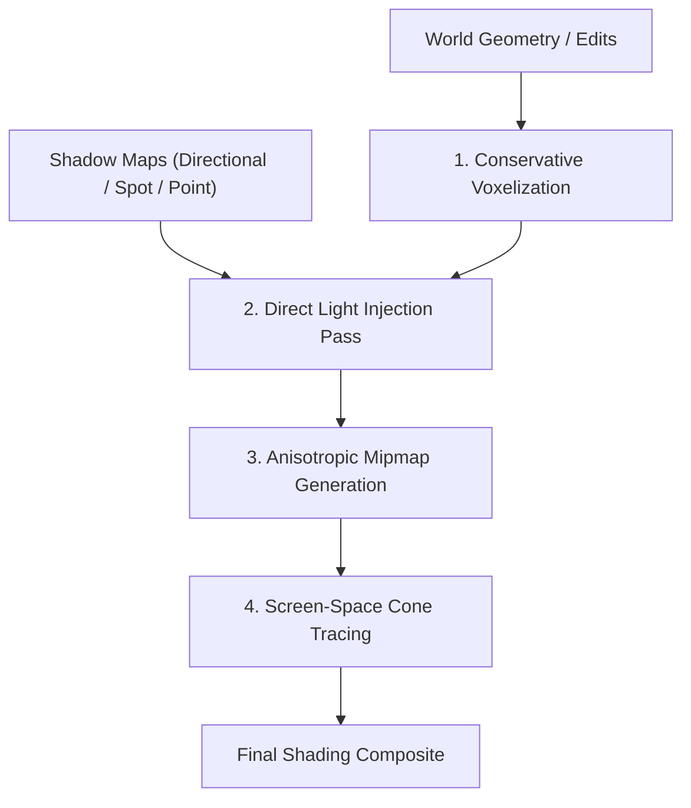

# 01. Voxel Cone Tracing (VCT)

## 1. Overview & Conceptual Foundation

Pioneered by Cyril Crassin et al. (GigaVoxels / Interactive Indirect Illumination Using Voxel Cone Tracing, 2011) and famously deployed in production by Q-Games for *The Tomorrow Children* (PS4), **Voxel Cone Tracing (VCT)** was one of the earliest real-time approximations of the full rendering equation:
$$L_o(\mathbf{x}, \omega_o) = L_e(\mathbf{x}, \omega_o) + \int_{\Omega} f_r(\mathbf{x}, \omega_i, \omega_o) L_i(\mathbf{x}, \omega_i) (\mathbf{n} \cdot \omega_i) \, d\omega_i$$

Instead of tracing hundreds of stochastic Monte Carlo ray samples per pixel—which produces noisy grain requiring heavy temporal accumulation—VCT approximates the hemispherical radiance integral using **a small set of wide conical beams** marching through a pre-filtered, mipmapped 3D voxel representation of the world.

---

## 2. 3D Nested Clipmap Architecture

In real-time implementations (such as *The Tomorrow Children*), allocating a single high-resolution 3D texture for an entire world is impossible ($1024^3 \times 16\text{ bytes} \approx 16\text{ GB}$).

VCT uses **Cascaded 3D Clipmaps**:
- $L$ nested 3D textures (typically $L = 4$ or $5$), each of dimensions $128^3$ or $256^3$, centered on the camera.
- Level 0 covers $[ -R_0, R_0 ]^3$ with voxel resolution $h_0$ (e.g. $6.25\text{ cm}$).
- Level $l$ covers $2^l R_0$ with voxel size $h_l = 2^l h_0$.

### 2.1 Anisotropic Directional Opacity & Radiance
A major limitation of isotropic (scalar) 3D mipmaps is that averaging solid voxels and empty air creates semi-transparent "ghost" voxels, causing catastrophic light leakage through thin 1-voxel walls.

To solve this, each voxel cell stores **6 directional values** ($\pm X, \pm Y, \pm Z$):
- Each direction stores emitted/reflected radiance (RGB) and directional opacity ($\alpha$).
- Downsampling from fine to coarse mip levels computes directional occlusion across the 8 sub-voxels:
  $$\alpha_{\text{parent}, +x} = 1 - (1 - \alpha_{\text{front}, +x}) \cdot (1 - \alpha_{\text{back}, +x})$$
  $$L_{\text{parent}, +x} = L_{\text{front}, +x} + (1 - \alpha_{\text{front}, +x}) \cdot L_{\text{back}, +x}$$

---

## 3. The 4-Step VCT Pipeline



### Step 1: Conservative Voxelization
To prevent cracks and pinholes in thin geometry, triangle bounds are expanded by half the voxel diagonal in the GPU geometry shader, forcing conservative rasterization.

### Step 2: Direct Light Injection
- Render scene shadow maps.
- A compute dispatch unprojects shadow map texels into world coordinates, finds the matching clipmap cell, and injects direct sunlight:
  $$L_{\text{direct}} = L_{\text{sun}} \cdot \max(0, \mathbf{n} \cdot \mathbf{l}) \cdot \rho_{\text{albedo}}$$
- Written into Level 0 using atomic operations (`atomicMax` or fixed-point additions).

### Step 3: Anisotropic Mipmapping
Downsample Level 0 through Level $L-1$ using directional self-shadowing passes in compute shaders.

### Step 4: Screen-Space Cone Tracing
For each G-buffer surface pixel, step cones through the 3D mipmapped clipmaps.

---

## 4. Cone Tracing Mathematics & Integration

A cone is defined by origin $\mathbf{x}_0$, direction $\mathbf{d}$, and half-aperture angle $\theta / 2$.
At distance $t$, the cone diameter is:
$$D(t) = 2 t \tan(\theta/2)$$

The continuous Level of Detail (LOD) $\lambda(t)$ sampled in the 3D texture is:
$$\lambda(t) = \log_2\left( \frac{D(t)}{h_0} \right)$$

### 4.1 Diffuse Cone Distribution
The upper hemisphere above surface normal $\mathbf{n}$ is spanned by **5 to 9 wide cones**:
- 1 central cone along normal $\mathbf{n}$ (aperture $\approx 60^\circ$, weight $\pi/4$).
- 4 to 6 side cones tilted at $45^\circ\text{--}60^\circ$ relative to $\mathbf{n}$ (aperture $\approx 60^\circ$, $\tan(\theta/2) \approx 0.577$).

### 4.2 Specular Reflections
A single narrow cone is traced along the specular reflection direction $\mathbf{r} = \text{reflect}(-\mathbf{v}, \mathbf{n})$:
$$\theta_{\text{spec}} = \arctan(\text{roughness}^2 \cdot \sqrt{2})$$
- For perfectly smooth mirror materials ($\text{roughness} \to 0$), the cone collapses into a single line ray.

```glsl
vec4 TraceCone(vec3 origin, vec3 dir, float tanHalfAngle, float maxDist) {
    vec3 accumColor = vec3(0.0);
    float accumAlpha = 0.0;
    float dist = h_0 * 1.5; // Offset past self-occlusion

    while (dist < maxDist && accumAlpha < 0.95) {
        float diameter = 2.0 * dist * tanHalfAngle;
        float lod = log2(diameter / h_0);
        
        vec4 sampleVal = SampleClipmapAnisotropic(origin + dir * dist, dir, lod);
        float stepSize = max(diameter, h_0);
        float correctedAlpha = 1.0 - pow(1.0 - sampleVal.a, stepSize / diameter);

        accumColor += (1.0 - accumAlpha) * correctedAlpha * sampleVal.rgb;
        accumAlpha += (1.0 - accumAlpha) * correctedAlpha;

        dist += stepSize * 0.75;
    }
    return vec4(accumColor, accumAlpha);
}
```

---

## 5. Failure Modes & Mitigations

1. **Light Bleeding:** Thin walls (1 voxel thick) leak light because trilinear mipmap filtering bleeds through boundaries.
   - *Mitigation:* Apply normal offset $\mathbf{x}_{\text{origin}} = \mathbf{x} + \mathbf{n} \cdot (\sqrt{3} h_0)$ and reject samples where $\mathbf{d} \cdot \mathbf{n}_{\text{voxel}} > 0$.
2. **Extreme Memory & Bandwidth:** Anisotropic clipmaps require **$180\text{--}380\text{ MB}$** of VRAM and consume over **$150\text{ GB/s}$ of texture filtering bandwidth**, making VCT heavy on lower-end GPUs.

---

## 6. Real-Time Performance Profile (RTX 3080 @ 1440p)

| Stage | Frame Time |
|---|---|
| **Direct Light Injection** | $1.2\text{--}1.8\text{ ms}$ |
| **Anisotropic Mipmap Compute** | $0.6\text{--}1.0\text{ ms}$ |
| **Diffuse Hemispherical Cone Tracing (6 cones)** | $2.5\text{--}3.8\text{ ms}$ |
| **Specular Cone Tracing (1 cone)** | $0.8\text{--}1.4\text{ ms}$ |
| **Total VCT Cost** | **$5.1\text{--}8.0\text{ ms}$** |
